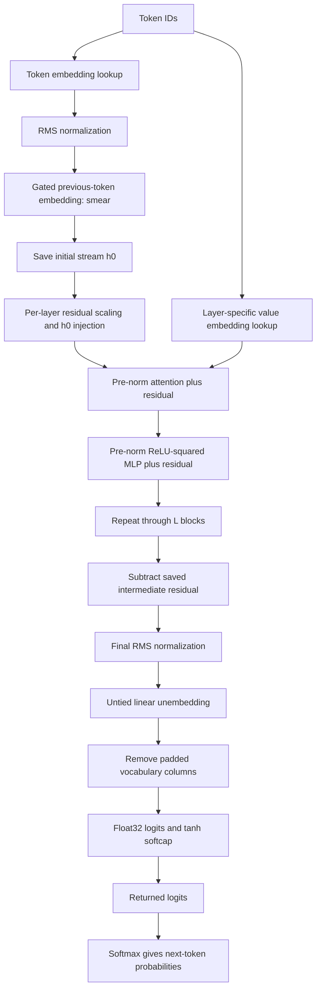

# The mathematics of nanochat's model architecture

This note reconstructs the complete model forward pass in the local nanochat checkout at commit `92d63d4e8bb4df75c3b71618f31ddde2378b2bcd`. It follows token IDs through embeddings, every transformer operation, and the output distribution. It also explains initialization and the cached forward path where these affect the architecture. Tokenizer training, datasets, optimization, loss objectives, post-training, sampling strategies, and serving are subjects for later notes.

The style follows your [Math Behind the Code](../transformer-from-scratch/MATH_BEHIND_THE_CODE.md). Comparisons refer to your checkout at `56092a1818027c800f08167ec0c1c65b983711e1`.

The main source is [GPT.forward](../nanochat/nanochat/gpt.py#L459), together with [Block.forward](../nanochat/nanochat/gpt.py#L150), [CausalSelfAttention.forward](../nanochat/nanochat/gpt.py#L84), [MLP.forward](../nanochat/nanochat/gpt.py#L137), and [GPT.init_weights](../nanochat/nanochat/gpt.py#L204). Attention mask semantics also come from [_sdpa_attention](../nanochat/nanochat/flash_attention.py#L77). Equations describe real arithmetic unless a numerical qualification is stated.

Code links include line fragments such as `gpt.py#L42` to open the relevant line in VS Code's Markdown preview. These line numbers refer to the source snapshot above and may need updating if the repositories change.

**How to read the explanations:** an algebraic property follows from the equations; an architectural motivation is a plausible reason to choose an operation; an empirical choice is a setting whose effectiveness requires measurement. The code establishes the implemented function, but does not establish that every modification is universally beneficial.

## Contents

1. [Notation and conventions](#1-notation-and-conventions)
2. [The complete computational path](#2-the-complete-computational-path)
3. [RMS normalization](#3-rms-normalization)
4. [Token embeddings and vocabulary padding](#4-token-embeddings-and-vocabulary-padding)
5. [Embedding smear](#5-embedding-smear)
6. [The residual stream and input reinjection](#6-the-residual-stream-and-input-reinjection)
7. [Attention, from projections to output](#7-attention-from-projections-to-output)
8. [The dense ReLU-squared MLP](#8-the-dense-relu-squared-mlp)
9. [Mid-layer backout and final normalization](#9-mid-layer-backout-and-final-normalization)
10. [Unembedding, softcapping, and probabilities](#10-unembedding-softcapping-and-probabilities)
11. [The whole model as equations](#11-the-whole-model-as-equations)
12. [The cached forward pass](#12-the-cached-forward-pass)
13. [Initialization and the initial function](#13-initialization-and-the-initial-function)
14. [Parameter counts and computational cost](#14-parameter-counts-and-computational-cost)
15. [Comparison with your implementation](#15-comparison-with-your-implementation)
16. [Small checks for understanding](#16-small-checks-for-understanding)
17. [Implementation details easy to misread](#17-implementation-details-easy-to-misread)

## 1. Notation and conventions

| Symbol | Meaning |
| --- | --- |
| $B$ | Batch size |
| $T$ | Number of token positions in the current call |
| $S$ | Configured context length, `config.sequence_len` |
| $L$ | Number of transformer blocks, indexed $\ell=0,\ldots,L-1$ |
| $d$ | Residual-stream width, `config.n_embd` |
| $H$ | Number of query heads, `config.n_head` |
| $H_{kv}$ | Number of key/value heads, `config.n_kv_head` |
| $D=d/H$ | Dimension of each attention head |
| $d_{kv}=H_{kv}D$ | Combined width of the key or value heads |
| $g=H/H_{kv}$ | Number of query heads sharing each KV head |
| $V$ | Actual vocabulary size |
| $V_p=64\lceil V/64\rceil$ | Allocated vocabulary size, using the default padding multiple |
| $X\in\{0,\ldots,V-1\}^{B\times T}$ | Input token IDs |
| $h^{(\ell)}\in\mathbb R^{B\times T\times d}$ | Residual stream entering block $\ell$ before its scalar mixing |
| $N_n$ | RMS normalization over the last dimension of width $n$ |

Batch indices are suppressed when the operation acts independently on each example. Token and head indices are zero-based. Matrix products act on the final feature dimension.

**Weight convention:** PyTorch stores a linear weight as $W\in\mathbb R^{d_{out}\times d_{in}}$ and computes $xW^\top$. We use that convention throughout. There are no additive biases in this model's linear layers.

Shape constraints include $d=HD$, $H_{kv}\mid H$, and even $D$ for RoPE. The fixed gate slices also require $d\ge24$ for the architecture as written. Use $L\ge1$ and a nonempty attention-window pattern.

For a concrete reference configuration, `GPTConfig()` specifies:

$$
L=12,\quad d=768,\quad H=H_{kv}=6,\quad D=128,\quad
V=32768,\quad S=2048.
$$

These are the [GPTConfig dataclass defaults](../nanochat/nanochat/gpt.py#L29), not necessarily the configuration selected by a run script. In [build_model_meta](../nanochat/scripts/base_train.py#L129), the trainer derives width and head counts from depth and explicitly sets $H_{kv}=H$. The implementation supports GQA, while that builder selects ordinary multi-head attention.

## 2. The complete computational path



The recurrence through all $L$ blocks is expanded below; the diagram abbreviates that repetition. Every residual addition preserves shape $B\times T\times d$.

Position information enters through RoPE inside attention and through the ordered previous-token operation in smear. There is no learned absolute-position embedding table. Value embeddings form an additional path from token identity into selected attention layers.

## 3. RMS normalization

**Code:** [norm — gpt.py, line 42](../nanochat/nanochat/gpt.py#L42). Compare with [your RMSNorm.forward](../transformer-from-scratch/model.py#L17).

For a feature vector $u\in\mathbb R^n$, define

$$
\rho(u)=\sqrt{\frac1n\sum_{j=0}^{n-1}u_j^2+\epsilon},
\qquad
N_n(u)_i=\frac{u_i}{\rho(u)}.
$$

The reduction is over the last dimension only. Thus $N_d$ normalizes each token's residual vector independently, while $N_D$ normalizes each query or key head independently.

Nanochat calls `F.rms_norm(x, (x.size(-1),))`, passing neither a scale parameter nor an explicit epsilon. There is no learned $\gamma_i$ and no learned shift. Your `RMSNorm` instead computes $\gamma_i u_i/\rho(u)$ with an explicit `eps=1e-6`.

**Numerical detail:** keep $\epsilon$ explicit when reproducing the function. Nanochat delegates its value to PyTorch. In the pinned PyTorch 2.9.1 composite implementation, fp16/bf16 inputs are accumulated in fp32 and the omitted epsilon is fp32 machine epsilon; the public 2.9 documentation describes the default differently. Exact backend/compiler reproduction therefore requires checking the executed implementation rather than substituting your model's $10^{-6}$. See the [versioned PyTorch source](https://github.com/pytorch/pytorch/blob/v2.9.1/aten/src/ATen/native/layer_norm.cpp#L245-L296).

### 3.1 What normalization controls

Let $m_2=\|u\|_2^2/n$. Then

$$
\frac1n\|N_n(u)\|_2^2=\frac{m_2}{m_2+\epsilon}\le1.
$$

For nonzero $u$ with $m_2\gg\epsilon$, the output has RMS approximately one and Euclidean norm approximately $\sqrt n$. Normalization controls overall magnitude while preserving relative coordinate values. The output generally has a nonzero mean because no mean is subtracted.

Ignoring $\epsilon$, positive scalar rescaling disappears:

$$
N_n(a u)=N_n(u),\qquad a>0.
$$

This property reduces sensitivity to incoming activation scale. A negative scalar also reverses the vector's direction.

The Jacobian makes the geometry explicit:

$$
J_{N_n}(u)=\frac{I}{\rho(u)}-
\frac{u u^\top}{n\rho(u)^3}.
$$

When $\epsilon=0$, the radial direction is removed: $J_{N_n}(u)u=0$. Changes transverse to $u$ can still change the normalized representation. This distinction will help explain why backout can matter even though it is followed by normalization.

### 3.2 Why use this form?

RMSNorm gives a comparatively simple way to control activation magnitude without centering. Omitting learned normalization scales reduces parameters and operations; neighboring projections still provide learned channel mixing and reweighting. This is an architectural choice, not a statement that learned scales are always redundant throughout the complete network.

Nanochat uses normalization after the input embedding, before each attention branch, before each MLP branch, on each query/key head, and before unembedding. It does not normalize values or apply a separate post-norm after every residual addition.

### 3.3 Why omit learnable normalization scales?

A learned coordinate scale can often be absorbed into the next projection. With the row-vector convention used here,

$$
\left(N_d(x)\odot\gamma\right)W^\top
=N_d(x)\left(W\mathrm{diag}(\gamma)\right)^\top
=N_d(x)\widetilde W^\top.
$$

Since $W$ is learned, this particular composition retains the same expressiveness without a separate $\gamma$. If several linear projections read the normalized vector, each can absorb the scaling. This is a local argument: it does not establish equivalence of the entire architecture. Separate scale parameters also change optimization and regularization, even when the represented functions are equivalent.

For query/key normalization, omitting learned scales additionally preserves the controlled head magnitudes: after the fixed factor 1.2, each nonzero head has norm approximately $1.2\sqrt D$. A learned coordinate scale applied afterward could change both magnitude and directional weighting, weakening that constraint.

These considerations motivate letting projections learn feature weighting while normalization controls magnitude. Whether omitting scales improves results remains an empirical question.

## 4. Token embeddings and vocabulary padding

**Code:** [vocabulary padding and embedding construction](../nanochat/nanochat/gpt.py#L170), [embedding lookup and normalization](../nanochat/nanochat/gpt.py#L470), and [Linear.forward](../nanochat/nanochat/gpt.py#L49).

The learned token table is

$$
E\in\mathbb R^{V_p\times d}.
$$

For each token,

$$
e^{raw}_{b,t,:}=E_{X_{b,t},:},\qquad
e_{b,t,:}=N_d(e^{raw}_{b,t,:}).
$$

Both tensors have shape $B\times T\times d$. An embedding is an indexed row lookup; expressing it as multiplication by a one-hot vector is mathematically valid but would be wasteful computationally.

Padding allocates enough vocabulary rows for a multiple of 64. Alignment can improve matrix-kernel efficiency. Valid token IDs remain below $V$, and output columns at indices $V,\ldots,V_p-1$ are removed before probabilities are defined. Extra rows do not represent extra language tokens.

The code converts activations to `COMPUTE_DTYPE` before normalization. Its custom `Linear.forward` casts each linear weight to the incoming activation dtype for the matrix product. These casts affect numerical approximation, not the mathematical dimensions or connectivity described here. Logits are explicitly promoted to fp32 later.

Compared with your model, the new operation at this point is the embedding RMSNorm: your initial stream is the raw embedding lookup.

## 5. Embedding smear

**Code:** [smear forward computation](../nanochat/nanochat/gpt.py#L475) and [smear parameter definitions](../nanochat/nanochat/gpt.py#L184).

Let

$$
w_s\in\mathbb R^{24},\qquad \lambda_s\in\mathbb R,
\qquad \sigma(a)=\frac1{1+e^{-a}}.
$$

For $t\ge1$, calculate one scalar gate from the current normalized embedding:

$$
s_{b,t}=\lambda_s\,
\sigma\!\left(\sum_{j=0}^{23}(w_s)_j e_{b,t,j}\right).
$$

Then define the initial residual stream:

$$
h^{(0)}_{b,0,:}=e_{b,0,:},
\qquad
h^{(0)}_{b,t,:}=e_{b,t,:}+s_{b,t}e_{b,t-1,:}\quad(t\ge1).
$$

The gate has shape $B\times(T-1)\times1$ and broadcasts over $d$ features. The previous vector is the **unsmeared normalized embedding**. This is a single neighboring-token operation, rather than a recurrence that repeatedly smears already mixed vectors.

### 5.1 Why add a previous-token path?

This supplies cheap local, bigram-like information before attention. The gate allows the contribution to depend on the current token's embedding, while the shared coefficient $\lambda_s$ controls overall strength. Only the first 24 channels feed the gate, keeping its projection small; the number 24 is an empirical implementation choice.

Because $\lambda_s$ is an unconstrained learned scalar, the effective contribution can become negative. The sigmoid alone does not make the entire mixture convex, and no requirement forces the coefficients of the two vectors to sum to one.

The operation is causal because $h^{(0)}_t$ depends only on token IDs at $t$ and $t-1$. The first token has no predecessor within a fresh sequence. There is no post-smear normalization before saving `x0`; subsequent branch normalizations handle its changed magnitude.

Initialization sets $\lambda_s=0$, so smear initially contributes zero. The exact initial function is discussed in section 13.

## 6. The residual stream and input reinjection

**Code:** [initial-stream reinjection and block loop](../nanochat/nanochat/gpt.py#L494) and [Block.forward](../nanochat/nanochat/gpt.py#L150).

Each block has learned scalars

$$
\alpha_\ell=\texttt{resid\_lambdas}[\ell],\qquad
\beta_\ell=\texttt{x0\_lambdas}[\ell].
$$

Start the block by forming

$$
r^{(\ell)}=\alpha_\ell h^{(\ell)}+
\beta_\ell h^{(0)}.
$$

Then apply the two residual branches in order:

$$
a^{(\ell)}=r^{(\ell)}+
A_\ell\!\left(N_d(r^{(\ell)});X\right),
$$

$$
h^{(\ell+1)}=a^{(\ell)}+
M_\ell\!\left(N_d(a^{(\ell)})\right).
$$

$A_\ell$ is attention, including its token-dependent value-embedding path; $M_\ell$ is the MLP. All three residual tensors have shape $B\times T\times d$.

### 6.1 The order matters

The MLP reads a normalization of the stream **after** attention has been added. The attention and MLP branches therefore do not read the same tensor in parallel.

The identity path retains the unnormalized stream. Normalization occurs on each branch's input. This is the same pre-norm residual pattern used in your `Block`, with the extra $\alpha_\ell,\beta_\ell$ mixing at the start.

Holding $h^{(0)}$ fixed, the block's local Jacobian with respect to $h^{(\ell)}$ is

$$
\frac{\partial h^{(\ell+1)}}{\partial h^{(\ell)}}=
\left(I+J_{M_\ell\circ N_d}(a^{(\ell)})\right)
\left(I+J_{A_\ell\circ N_d}(r^{(\ell)})\right)
\alpha_\ell I.
$$

Here Jacobians act on vectorized tensors and are evaluated at the stated inputs. The residual additions supply identity terms even if branch derivatives are small. This supports signal propagation without guaranteeing uniformly well-conditioned gradients at arbitrary depth.

$\beta_\ell h^{(0)}$ creates additional direct paths from the initial token representation to deeper blocks. Parameter gradients also flow through the reinjected initial representation and the independent value-embedding lookups. Token IDs themselves are discrete indices; ordinary derivatives with respect to those integer IDs are not defined.

### 6.2 What do the scalars change?

They control the relative contribution of the accumulated stream and initial representation. A common positive rescaling can disappear inside RMSNorm, but changing their relative contributions can change direction. Moreover, their mixture is retained in the unnormalized residual path. Their effect cannot generally be inferred from branch normalization alone.

The scalars are shared over all batches, tokens, and channels within a layer. They are not token-dependent gates, and their values are not constrained to be positive.

## 7. Attention, from projections to output

**Code:** [CausalSelfAttention.__init__](../nanochat/nanochat/gpt.py#L68), [CausalSelfAttention.forward](../nanochat/nanochat/gpt.py#L84), [has_ve](../nanochat/nanochat/gpt.py#L53), [apply_rotary_emb](../nanochat/nanochat/gpt.py#L57), and [GPT._compute_window_sizes](../nanochat/nanochat/gpt.py#L287).

For a fixed layer, let

$$
U=N_d(r^{(\ell)})\in\mathbb R^{B\times T\times d}.
$$

All projections and the value gate below read this same normalized attention input.

### 7.1 Query, key, and value projections

**Code:** [projection matrices](../nanochat/nanochat/gpt.py#L77) and [projection/reshape operations](../nanochat/nanochat/gpt.py#L89).

The learned matrices are

$$
W_Q\in\mathbb R^{d\times d},\quad
W_K,W_V\in\mathbb R^{d_{kv}\times d},\quad
W_O\in\mathbb R^{d\times d}.
$$

Compute and reshape:

$$
Q^0=\mathrm{reshape}(UW_Q^\top)
\in\mathbb R^{B\times T\times H\times D},
$$

$$
K^0=\mathrm{reshape}(UW_K^\top),\qquad
V^0=\mathrm{reshape}(UW_V^\top)
\in\mathbb R^{B\times T\times H_{kv}\times D}.
$$

Reshaping partitions the projected channel dimension into heads without changing values. Nanochat keeps the layout `(B, T, H, D)` for its Flash Attention interface; the SDPA fallback transposes to `(B, H, T, D)` internally.

### 7.2 Gated value embeddings

**Code:** [layer selection](../nanochat/nanochat/gpt.py#L53), [value tables](../nanochat/nanochat/gpt.py#L189), and [gated value addition](../nanochat/nanochat/gpt.py#L93).

Only layers satisfying

$$
\ell\bmod2=(L-1)\bmod2
$$

have value embeddings. Thus the final layer always has them. For $L=12$, the active indices are $1,3,5,7,9,11$.

Each active layer owns an independent table

$$
E^{VE}_\ell\in\mathbb R^{V_p\times d_{kv}},
$$

and an independent gate matrix

$$
W_{G,\ell}\in\mathbb R^{H_{kv}\times12}.
$$

Look up the original token ID and reshape:

$$
Z_{b,t,:,:}=\mathrm{reshape}
\left(E^{VE}_\ell[X_{b,t},:]\right)
\in\mathbb R^{H_{kv}\times D}.
$$

For KV head $k$, calculate

$$
G_{b,t,k}=3\sigma\!\left(
\sum_{j=0}^{11}(W_{G,\ell})_{k,j}U_{b,t,j}
\right),
$$

$$
V_{b,t,k,:}=V^0_{b,t,k,:}+G_{b,t,k}Z_{b,t,k,:}.
$$

The gate has shape $B\times T\times H_{kv}$; `unsqueeze(-1)` broadcasts it across $D$. In inactive layers, $V=V^0$.

**Interpretation:** the contextual stream supplies $V^0$, while the token-ID table supplies a separate token-specific value vector. The contextual gate controls how strongly to add that vector. This gives token identity a direct route into deeper attention values even after the residual stream has undergone many transformations.

The code labels this a ResFormer-style value residual. In this implementation, the tables are independent per active layer; this is not simply a copy of another layer's projected values. Gates lie in $(0,3)$, but vectors can have either sign and the addition is not a convex interpolation. The number 12, factor 3, and alternating-layer placement are empirical choices.

Values receive neither RoPE nor the query/key RMS normalization.

### 7.3 Rotary positional embeddings

**Code:** [rotation of coordinate pairs](../nanochat/nanochat/gpt.py#L57), [frequency/table construction](../nanochat/nanochat/gpt.py#L270), and [position-offset slicing](../nanochat/nanochat/gpt.py#L466).

The head dimension $D$ is even. Set $m=D/2$, and for $j=0,\ldots,m-1$ define

$$
\omega_j=100000^{-2j/D},\qquad
\theta_{p,j}=p\omega_j.
$$

Here $p$ is the absolute token position: $p=t$ in an uncached sequence and $p=p_0+t$ when extending a cache at position $p_0$.

Nanochat splits a head vector into two halves and pairs coordinates $(j,j+m)$. For either a query or key vector $u$, the rotation is

$$
\begin{pmatrix}
u'_{j}\\u'_{j+m}
\end{pmatrix}
=
\begin{pmatrix}
\cos\theta_{p,j}&\sin\theta_{p,j}\\
-\sin\theta_{p,j}&\cos\theta_{p,j}
\end{pmatrix}
\begin{pmatrix}
u_j\\u_{j+m}
\end{pmatrix}.
$$

This is rotation by $-\theta_{p,j}$ under the usual planar convention. It is applied to every query head and every key head over the full head dimension.

For the usual positive-angle matrix $R$, a query at $p$ and key at $s$ satisfy, within one coordinate pair,

$$
\big(R(-p\omega_j)q\big)^\top
\big(R(-s\omega_j)k\big)
=q^\top R((p-s)\omega_j)k.
$$

The positional dependence of the dot product is therefore a function of relative displacement. The sign convention is internally consistent because both queries and keys use it. Pairing halves rather than adjacent coordinates is a coordinate convention; converting between conventions also requires consistently permuting projected coordinates.

Your attention rotates only a subset of each head and uses adjacent coordinate pairs with base 10000. Nanochat rotates the entire query/key head and uses base 100000. A larger base lowers the higher-index frequencies and lengthens their wavelengths. This alters the relative-position features; it does not by itself guarantee reliable generalization to longer contexts.

The precomputed cosine and sine tables have shape

$$
(1,10S,1,D/2).
$$

The model slices the relevant positions and broadcasts over batch and heads. These are deterministic buffers, not learned parameters, and are excluded from saved state dictionaries via `persistent=False`.

### 7.4 QK normalization and attention scale

**Code:** [RoPE, QK normalization, and factors of 1.2](../nanochat/nanochat/gpt.py#L99).

Let $Q^R,K^R$ be the rotated projections. Nanochat computes

$$
\widehat Q=1.2\,N_D(Q^R),\qquad
\widehat K=1.2\,N_D(K^R).
$$

Each head is normalized independently over its $D$ coordinates. The backend still applies the standard $1/\sqrt D$ dot-product scale; the SDPA call passes no overriding `scale`. See the [versioned SDPA definition](https://docs.pytorch.org/docs/2.9/generated/torch.nn.functional.scaled_dot_product_attention.html).

For nonzero head vectors with negligible epsilon, writing $\phi$ for their angle gives

$$
\frac{\widehat q^\top\widehat k}{\sqrt D}
\approx1.44\sqrt D\cos\phi.
$$

Thus QK RMSNorm produces an angle-based score with a fixed scale. It is not unit-length normalization followed by an unscaled cosine. Since each normalized head has norm at most $\sqrt D$, the unmasked score obeys the real-arithmetic bound

$$
\left|\frac{\widehat q^\top\widehat k}{\sqrt D}\right|
\le1.44\sqrt D.
$$

Without QK normalization, increasing projection norms can arbitrarily increase attention logits. Here norms are controlled, and multiplying both sides by 1.2 increases the dot-product scale by $1.2^2=1.44$, sharpening attention relative to the same normalized vectors without that factor. The constant 1.2 is empirical.

Orthogonal rotations preserve norms, so RoPE and this parameter-free RMSNorm commute in exact arithmetic. Their implemented order is rotation, normalization, scaling. Finite-precision paths need not be bitwise identical under reordering.

The usual variance argument also explains the retained $1/\sqrt D$: for independent, zero-mean, unit-variance coordinates, $\mathrm{Var}(q^\top k)\approx D$. Dividing by $\sqrt D$ gives order-one variance. For independent isotropic normalized directions, cosine fluctuations are similarly of order $D^{-1/2}$. These are scale heuristics, not independence assumptions guaranteed for learned heads.

### 7.5 Which KV head does each query head use?

**Code:** [head-count constraints](../nanochat/nanochat/gpt.py#L75) and [SDPA GQA dispatch](../nanochat/nanochat/flash_attention.py#L134).

For query head $h\in\{0,\ldots,H-1\}$, define

$$
\kappa(h)=\left\lfloor\frac h g\right\rfloor,
\qquad g=H/H_{kv}.
$$

Consecutive groups of $g$ query heads share one key head and one value head. Each query head still has its own query projection and attention distribution.

If $H_{kv}=H$, each query head uses a distinct KV head. If $H_{kv}=1$, all query heads share one KV head. Intermediate values give GQA. Sharing reduces KV projection width and cache storage by $H/H_{kv}$ relative to otherwise matching ordinary multi-head attention, while retaining $H$ query heads.

### 7.6 Causal and sliding-window masks

**Code:** [per-layer window construction](../nanochat/nanochat/gpt.py#L287) and [SDPA causal/local masks](../nanochat/nanochat/flash_attention.py#L77).

Let $w_\ell$ be the number of allowed preceding positions in this layer. For an uncached sequence, position $t$ may attend to

$$
\mathcal J_\ell(t)=
\{s:\max(0,t-w_\ell)\le s\le t\}.
$$

This includes the current position and up to $w_\ell$ predecessors: at most $w_\ell+1$ keys.

With $S=\texttt{sequence\_len}$, the exact code gives

$$
w_{long}=S,\qquad
w_{short}=128\left\lceil\frac S{512}\right\rceil.
$$

The short formula is the integer expression `-(-S // 4 // 128) * 128`. For $S=2048$, it evaluates to **512**, so an interior short-window query can read 513 keys including itself. The inline comment saying `2048 -> 768` disagrees with the expression.

The `window_pattern` is tiled across layers, and the final layer is forced to long. For `SSSL` and $L=12$, the pattern is

```text
layer:    0 1 2 3 4 5 6 7 8 9 10 11
window:   S S S L S S S L S S S  L
```

During a full pass of length $T\le S$, a long layer can see the entire available prefix. For sequences extending beyond $S$, its finite left window remains $S$; the configured long window is not unlimited.

Local layers reduce attention work and emphasize nearby context. Interleaved long layers provide direct access across the configured context. Even several local layers can transmit information beyond one local window through successive representations. A BOS token does not create an attention barrier: these masks depend on positions and windows, not document or conversation boundaries.

### 7.7 Attention scores, softmax, and value aggregation

**Code:** [model attention call](../nanochat/nanochat/gpt.py#L106) and [backend dispatch](../nanochat/nanochat/flash_attention.py#L115). The dot products, softmax, and weighted sum are executed inside the selected backend.

For batch $b$, query position $t$, key position $s$, and query head $h$, define

$$
M^{(\ell)}_{t,s}=
\begin{cases}
0,&s\in\mathcal J_\ell(t),\\
-\infty,&\text{otherwise}.
\end{cases}
$$

The score and probability are

$$
C_{b,h,t,s}=
\frac{\widehat Q_{b,t,h,:}^{\top}
\widehat K_{b,s,\kappa(h),:}}{\sqrt D}
+M^{(\ell)}_{t,s},
$$

$$
P_{b,h,t,s}=
\frac{\exp C_{b,h,t,s}}
{\sum_{u\in\mathcal J_\ell(t)}\exp C_{b,h,t,u}}.
$$

Masked positions have zero probability. Softmax is over **key positions** for each batch, query head, and query position. A numerically stable implementation subtracts the row maximum before exponentiation, leaving probabilities unchanged.

The head output is

$$
Y_{b,t,h,:}=
\sum_{s\in\mathcal J_\ell(t)}
P_{b,h,t,s}\,V_{b,s,\kappa(h),:}.
$$

Each head output is a convex combination of that KV head's values. This statement concerns the attention weights; the value-embedding addition and final output projection impose no convexity constraint on the overall attention branch.

### 7.8 Concatenate heads and project back

**Code:** [head concatenation and output projection](../nanochat/nanochat/gpt.py#L125).

Concatenate the $H$ head outputs:

$$
Y^{cat}\in\mathbb R^{B\times T\times HD}
=\mathbb R^{B\times T\times d},
\qquad
A_\ell(U;X)=Y^{cat}W_O^\top.
$$

The output projection mixes information across heads and returns a vector compatible with the residual stream. `contiguous().view(B, T, -1)` performs the layout/reshape step; it introduces no learned operation.

The block then adds this branch output to $r^{(\ell)}$. There is no attention dropout or residual dropout in this model.

### 7.9 What Flash Attention changes

**Code:** [Flash Attention/SDPA wrapper](../nanochat/nanochat/flash_attention.py#L115).

The model calls either Flash Attention 3 or the SDPA fallback through the same wrapper. The intended mathematical operation is the masked scaled-dot-product attention just derived.

Efficient kernels tile the computation and can avoid materializing the entire $B\times H\times T\times T$ score/probability tensors. Dense attention still has quadratic pairwise arithmetic. The equations describe a conceptual matrix even when the implementation never stores that matrix in full. Kernel choice can change roundoff and memory traffic; it does not add another learned attention mechanism.

## 8. The dense ReLU-squared MLP

**Code:** [MLP projection definitions](../nanochat/nanochat/gpt.py#L131), [MLP.forward](../nanochat/nanochat/gpt.py#L137), and [MLP residual addition](../nanochat/nanochat/gpt.py#L152).

After attention, normalize the updated stream:

$$
F=N_d(a^{(\ell)})\in\mathbb R^{B\times T\times d}.
$$

The learned matrices are

$$
W_{up}\in\mathbb R^{4d\times d},\qquad
W_{down}\in\mathbb R^{d\times4d}.
$$

The computation is

$$
Z=FW_{up}^\top\in\mathbb R^{B\times T\times4d},
$$

$$
\Phi(Z)_{b,t,j}=\big(\max(0,Z_{b,t,j})\big)^2,
$$

$$
M_\ell(F)=\Phi(Z)W_{down}^\top
\in\mathbb R^{B\times T\times d},
$$

$$
h^{(\ell+1)}=a^{(\ell)}+M_\ell(F).
$$

Every position uses the same MLP weights, independently of other positions. Cross-position mixing happens in attention and smear. The MLP performs nonlinear channel mixing on the information already gathered at that position.

For a scalar input,

$$
\Phi(z)=
\begin{cases}
0,&z\le0,\\
z^2,&z>0,
\end{cases}
\qquad
\Phi'(z)=
\begin{cases}
0,&z\le0,\\
2z,&z>0.
\end{cases}
$$

ReLU-squared selects positive preactivations and amplifies them quadratically. It is continuously differentiable at zero, although its second derivative jumps there. The nonnegative intermediate activations can produce signed outputs because $W_{down}$ has signed entries.

The expansion to $4d$ creates more intermediate features before compressing back to $d$. Its factor 4 and activation choice are empirical design choices. This branch has $8d^2$ parameters and no dropout.

Your `MLPexperts` instead computes SwiGLU-like experts,

$$
\left(FW_{up}^\top\right)\odot
\mathrm{SiLU}\left(FW_{gate}^\top\right),
$$

followed by each expert's down projection and sparse routing/aggregation. Nanochat has no separate activation gate projection, no experts, no router, and no capacity mechanism. ReLU-squared is a simpler dense alternative; its inclusion does not establish that it is generally superior to SwiGLU.

## 9. Mid-layer backout and final normalization

**Code:** [saved-layer selection](../nanochat/nanochat/gpt.py#L497), [intermediate-stream capture](../nanochat/nanochat/gpt.py#L503), and [backout subtraction/final normalization](../nanochat/nanochat/gpt.py#L505).

Define

$$
m=\left\lfloor L/2\right\rfloor.
$$

Immediately after processing zero-based block $m$, save

$$
b_{mid}=h^{(m+1)}.
$$

After all blocks, compute

$$
\widetilde h=h^{(L)}-\gamma b_{mid},\qquad
u=N_d(\widetilde h),
$$

where $\gamma=\texttt{backout\_lambda}$ is one learned scalar, initialized to 0.2. For $L=12$, the saved tensor is after the seventh block. For $L=1$, it is the final block output itself.

The code's stated motivation is removing low-level features that persist in the residual stream. A precise algebraic interpretation is subtraction of an earlier representation before the output classifier. In the simplified special case $h^{(L)}=b_{mid}+\Delta$, this becomes $(1-\gamma)b_{mid}+\Delta$; the actual learned residual/input mixing makes the general decomposition more involved.

This operation is not an orthogonal projection. Orthogonally removing the component along a vector would require an input-dependent coefficient such as $\langle h,b\rangle/\langle b,b\rangle$, whereas $\gamma$ here is a single global learned parameter.

Why can backout survive final normalization? If $b_{mid}$ is not parallel to $h^{(L)}$, subtraction can change direction, and RMSNorm preserves that directional change. If the two are parallel and subtraction only produces a positive rescaling, its effect disappears when epsilon is neglected. This is a useful distinction between magnitude control and representational mixing.

Final normalization gives the classifier a controlled input norm. It does not bound classifier logits independently of the classifier weights.

## 10. Unembedding, softcapping, and probabilities

**Code:** [independent lm_head construction](../nanochat/nanochat/gpt.py#L177) and [unembedding, cropping, fp32 conversion, and softcap](../nanochat/nanochat/gpt.py#L510).

The output classifier has its own learned matrix

$$
W_U\in\mathbb R^{V_p\times d}.
$$

For every position,

$$
Z^{pad}_{b,t,:}=u_{b,t,:}W_U^\top
\in\mathbb R^{V_p}.
$$

Crop to the actual vocabulary and convert to fp32:

$$
Z_{b,t,:}=\mathrm{float32}
\left(Z^{pad}_{b,t,0:V}\right).
$$

Then apply the elementwise softcap with $c=15$:

$$
\bar Z_{b,t,v}=c\tanh\left(Z_{b,t,v}/c\right).
$$

The returned tensor, when `targets=None`, is $\bar Z\in\mathbb R^{B\times T\times V}$. `GPT.forward` does **not** itself return probabilities or sampled tokens. If targets are supplied, it returns a cross-entropy result instead; loss objectives and target masking are deferred to a later note.

### 10.1 Why untie the weights?

Your model explicitly assigns `unembedding.weight = token_embedding_table.weight`, so input and output share one matrix. Nanochat keeps $E$ and $W_U$ independent.

An input row represents a token when reading it. An output row acts as a classifier for predicting that token from context. Independent matrices let these roles specialize separately and permit different numerical scales. Weight tying saves $V_p d$ parameters relative to otherwise identical independent tables and imposes a coupling between those roles. Neither choice is universally optimal.

For the reference configuration, untying costs 25,165,824 additional parameters relative to tying the two main tables. Value-embedding tables remain separate in either accounting.

### 10.2 Why softcap after normalization?

For one output row $w_v$, Cauchy-Schwarz gives

$$
|Z_v|=|w_v^\top u|\le\|w_v\|_2\|u\|_2
\lesssim\sqrt d\,\|w_v\|_2.
$$

Final RMSNorm controls $\|u\|_2$, but the learned row norm $\|w_v\|_2$ can grow. Softcapping adds a direct bound:

$$
|\bar Z_v|<15,
\qquad
\frac{d\bar Z_v}{dZ_v}=\mathrm{sech}^2(Z_v/15).
$$

For $|Z_v|\ll15$, the transformation is approximately the identity. Large magnitudes saturate smoothly and have smaller derivatives. This can limit extreme confidence and large logit magnitudes, but can also attenuate signals in the saturated regime. The cap 15 is empirical.

### 10.3 The next-token distribution

The vocabulary distribution is defined by

$$
p_\theta(X_{t+1}=v\mid X_{\le t})=
\frac{\exp\bar Z_{t,v}}
{\sum_{j=0}^{V-1}\exp\bar Z_{t,j}}.
$$

The last position's logits predict the token following the supplied prefix. Earlier positions simultaneously define their own next-token distributions. Causality follows from the complete graph: smear uses only predecessors, attention uses causal masks, and other operations act positionwise.

This is a second kind of softmax in the architecture: attention softmax normalizes over key positions, while output softmax normalizes over vocabulary items. Output probabilities are defined only over the unpadded vocabulary.

Token selection and conversion back into text occur outside this forward map and will be discussed with inference.

## 11. The whole model as equations

This section collects the equations into one complete specification for an uncached sequence. For compactness, suppress batch indices and use the functions defined above.

### 11.1 Input

$$
e_t=N_d(E[X_t]),
$$

$$
h^{(0)}_t=
\begin{cases}
e_0,&t=0,\\
e_t+\lambda_s\sigma(w_s^\top e_{t,0:24})e_{t-1},&t>0.
\end{cases}
$$

### 11.2 For every layer $\ell=0,\ldots,L-1$

First mix and normalize:

$$
r^{(\ell)}_t=\alpha_\ell h^{(\ell)}_t+
\beta_\ell h^{(0)}_t,\qquad U_t=N_d(r^{(\ell)}_t).
$$

Project $U_t$ into heads:

$$
Q^0_t=\mathrm{reshape}(U_tW_{Q,\ell}^\top),\quad
K^0_t=\mathrm{reshape}(U_tW_{K,\ell}^\top),\quad
V^0_t=\mathrm{reshape}(U_tW_{V,\ell}^\top).
$$

Use the value table if present:

$$
V_{t,k}=
\begin{cases}
V^0_{t,k}+3\sigma((U_{t,0:12}W_{G,\ell}^\top)_k)
\mathrm{reshape}(E^{VE}_\ell[X_t])_k,
&\ell\bmod2=(L-1)\bmod2,\\
V^0_{t,k},&\text{otherwise}.
\end{cases}
$$

Apply the code's rotation $\mathcal R_t$, head normalization, and scale:

$$
\widehat Q_{t,h}=1.2N_D(\mathcal R_t Q^0_{t,h}),\qquad
\widehat K_{t,k}=1.2N_D(\mathcal R_t K^0_{t,k}).
$$

Compute attention over the allowed keys:

$$
P_{h,t,s}=\mathrm{softmax}_{s\in\mathcal J_\ell(t)}
\left(\frac{\widehat Q_{t,h}^\top
\widehat K_{s,\kappa(h)}}{\sqrt D}\right),
\qquad
Y_{t,h}=\sum_{s\in\mathcal J_\ell(t)}P_{h,t,s}V_{s,\kappa(h)}.
$$

Update both residual branches:

$$
a^{(\ell)}_t=r^{(\ell)}_t+
\mathrm{concat}_{h=0}^{H-1}(Y_{t,h})W_{O,\ell}^\top,
$$

$$
h^{(\ell+1)}_t=a^{(\ell)}_t+
\left[\mathrm{ReLU}
\left(N_d(a^{(\ell)}_t)W_{up,\ell}^\top\right)\right]^2
W_{down,\ell}^\top.
$$

Square brackets followed by $^2$ mean elementwise squaring, not a matrix square.

### 11.3 Readout

With $m=\lfloor L/2\rfloor$,

$$
u_t=N_d\!\left(h^{(L)}_t-\gamma h^{(m+1)}_t\right),
$$

$$
\bar Z_t=15\tanh\!\left(
\frac{(u_tW_U^\top)_{0:V}}{15}
\right),\qquad
p_t=\mathrm{softmax}_{v}(\bar Z_t).
$$

The implementation promotes logits to fp32 before applying the last tanh. This completes the map from token IDs to next-token probabilities.

## 12. The cached forward pass

**Code:** [cached positions](../nanochat/nanochat/gpt.py#L466), [cached smear](../nanochat/nanochat/gpt.py#L481), [attention cache calls](../nanochat/nanochat/gpt.py#L112), [KVCache](../nanochat/nanochat/engine.py#L82), and [flash_attn_with_kvcache](../nanochat/nanochat/flash_attention.py#L139).

Caching reuses results for past positions in the same causal model. It does not introduce learned parameters.

### 12.1 What is stored?

For each layer, cache

$$
K^{cache},V^{cache}
\in\mathbb R^{L\times B\times T_{max}\times H_{kv}\times D}.
$$

The stored keys are already rotated, normalized, and multiplied by 1.2. The stored values already contain the value-embedding addition where applicable. Queries are not cached: the current query reads past keys and values.

Also retain the previous token's normalized, unsmeared embedding,

$$
e_{previous}\in\mathbb R^{B\times1\times d},
$$

to reproduce smear on the next one-token call.

This differs from your `Multi_Headed_Latent_Attention`: your cache stores compressed latent vectors plus rotary keys, then reconstructs content keys and values. Nanochat stores full projected KV heads directly. GQA can reduce their number, but it is a different mechanism from latent compression.

### 12.2 Positions and masks

Suppose the cache contains $p_0$ positions and the new call supplies $T_{new}$ positions. RoPE uses absolute positions

$$
p=p_0,\ldots,p_0+T_{new}-1.
$$

Insert each layer's new keys and values into those cache slots. A query at absolute position $p$ may attend only to stored positions $s$ with

$$
\max(0,p-w_\ell)\le s\le p.
$$

For a single new token, every valid stored key is already in its past or at its own position. The SDPA fallback therefore uses `is_causal=False` after restricting the cache to valid positions and the applicable local window. Applying an ordinary one-row top-left triangular mask would incorrectly expose only the first key.

For a multi-token query chunk, the fallback builds an explicitly offset mask with absolute query row positions. The cache position advances by $T_{new}$ only after the final layer, so all layers use the same position offset within one call.

### 12.3 Smear state and supported equivalence

A normal initial prefill at $p_0=0$ applies the same smear equations as the uncached pass. On subsequent one-token calls,

$$
h^{(0)}_{new}=e_{new}+
\lambda_s\sigma(w_s^\top e_{new,0:24})e_{previous}.
$$

Update `prev_embedding` with $e_{new}$ before proceeding. Retaining the unsmeared embedding reproduces the original function.

**A boundary detail in this checkout:** when a cached call has $T_{new}>1$, the smear branch handles positions 1 onward inside that chunk but does not add the previous chunk's last embedding to the first new position. Thus initial prefill followed by one-token decoding reproduces full-prefix smear, while arbitrary later multi-token chunks need additional boundary handling for exact equivalence when $\lambda_s\ne0$. The attention mask itself handles chunk offsets; this limitation comes from smear.

The actual rotary-buffer requirement is $p_0+T_{new}\le10S$, and the allocated KV cache must also have enough slots. The assertion near the start of `GPT.forward` only checks the current call's $T$, so it does not alone guarantee the offset slice remains in bounds. Precomputing $10S$ rotary positions is an allocation decision, not evidence of language-model quality at that length.

`KVCache.get_pos` and the SDPA cache path assume equal current positions across batch rows. A cache can prefill a single-token prompt, but the uncached `GPT.forward` path currently asserts $T>1$ in its smear branch.

## 13. Initialization and the initial function

**Code:** [GPT.init_weights](../nanochat/nanochat/gpt.py#L204) and [model allocation/initialization](../nanochat/scripts/base_train.py#L146). The usual construction path uses a meta device for shapes, allocates storage with `to_empty`, then calls this method. Constructor placeholders and the summary docstring do not always match the actual initialized values.

Set

$$
s_0=\sqrt{3/d}.
$$

The executed initialization is:

| Parameter | Initialization |
| --- | --- |
| Main token table $E$ | Independent normal entries, standard deviation 0.8 |
| Unembedding $W_U$ | Independent normal entries, standard deviation 0.001 |
| $W_Q,W_K,W_V$ | Uniform entries in $[-s_0,s_0]$ |
| Attention output $W_O$ | Zero |
| MLP up projection $W_{up}$ | Uniform entries in $[-0.4s_0,0.4s_0]$ |
| MLP down projection $W_{down}$ | Zero |
| Each value table $E^{VE}_\ell$ | Uniform entries in $[-s_0,s_0]$ |
| Smear and value-gate weights | Uniform entries in $[0,0.02]$ |
| $\lambda_s$ | 0 |
| $\gamma$ | 0.2 |
| $\alpha_\ell$ | $1.15-0.10\ell/\max(L-1,1)$ |
| $\beta_\ell$ | $0.20-0.15\ell/\max(L-1,1)$ |

For $L>1$, the residual coefficient decreases from 1.15 to 1.05 and the input coefficient from 0.20 to 0.05. They do not initialize to the constructor's placeholder ones and zeros.

For a uniform random variable on $[-a,a]$,

$$
\mathrm{Var}(W)=a^2/3.
$$

Thus Q/K/V projection entries have standard deviation $1/\sqrt d$, and MLP-up entries have standard deviation $0.4/\sqrt d$. For approximately independent normalized input coordinates, a Q/K/V preactivation has variance approximately $d(1/d)=1$. This is the fan-in scale argument; the factor 0.4 further reduces MLP preactivation scale before squaring.

The uniform distribution bounds individual initial weights. It does not guarantee bounded activations independently of inputs, and the particular factors are empirically chosen.

Positive initial gate weights do not guarantee a positive gate preactivation because input coordinates have either sign. The value gate is approximately 1.5 for a preactivation near zero, while smear is exactly disabled by its zero coefficient.

### 13.1 Why zero the output projections?

Regardless of internal attention weights or MLP features, initially

$$
A_\ell=0,\qquad M_\ell=0.
$$

Each residual branch therefore starts with zero contribution. With $\lambda_s=0$, write

$$
h^{(\ell)}_t=c_\ell e_t,\qquad c_0=1.
$$

Then the exact scalar recurrence before numerical rounding is

$$
c_{\ell+1}=\alpha_\ell c_\ell+\beta_\ell.
$$

Consequently,

$$
\widetilde h_t=
\left(c_L-0.2c_{m+1}\right)e_t.
$$

The initialized coefficients make this a positive scalar multiple. Ignoring epsilon, final normalization removes that positive scalar. Initially the readout therefore depends on the current token embedding, with no cross-token contribution from attention or smear. Attention becomes influential when its output projection becomes nonzero.

Zeroing only the final projection allows that projection to receive a signal from nonzero internal features. Initially, derivatives into the branch's internal parameters are blocked by the zero final projection, while derivatives into the final projection need not vanish. This explains why zero output projections are compatible with the branch becoming active; the detailed optimization dynamics belong in a later note.

Under the independent small-weight approximation, the initial output logit standard deviation is

$$
\mathrm{std}(Z_v)\approx0.001\sqrt d,
$$

about 0.0277 for $d=768$. Initial output probabilities are consequently close to uniform rather than exactly uniform.

Your implementation instead initializes residual projections with a depth-scaled nonzero Gaussian and uses tied embeddings. These define a different initial function and scale structure.

## 14. Parameter counts and computational cost

### 14.1 Exact learned parameter count

**Code:** [GPT.num_scaling_params](../nanochat/nanochat/gpt.py#L390).

Let

$$
M=\lceil L/2\rceil
$$

be the number of value-embedding layers.

Each block's attention matrices contain

$$
P_{attn}=d^2+dd_{kv}+dd_{kv}+d^2
=2d^2+2dd_{kv}
$$

parameters. Its MLP contains $8d^2$. Each active value gate adds $12H_{kv}$ parameters, and its value table adds $V_pd_{kv}$.

The main embedding and independent unembedding contribute $2V_pd$. Global learned scalars and smear weights contribute

$$
L+L+24+1+1=2L+26.
$$

Thus the exact total is

$$
\boxed{
P=2V_pd+L(10d^2+2dd_{kv})
+M(V_pd_{kv}+12H_{kv})+2L+26.
}
$$

There are no norm parameters or bias parameters. Rotary buffers and KV caches are not learned parameters.

For the reference dataclass configuration:

| Component | Parameters |
| --- | ---: |
| Main token table | 25,165,824 |
| Unembedding | 25,165,824 |
| Twelve blocks' attention and MLP matrices, excluding value gates | 84,934,656 |
| Six independent value tables | 150,994,944 |
| Six value-gate matrices | 432 |
| Residual scalars, smear parameters, and backout scalar | 50 |
| **Total** | **286,261,730** |

The value tables dominate parameter count in this configuration even though they are lookups rather than dense token-stream matrix multiplications. This is why parameter capacity and per-token matrix-multiplication cost must be distinguished. `GPT.num_scaling_params` exposes separate parameter categories for this reason.

### 14.2 Forward computation

**Code:** [GPT.num_matmul_params](../nanochat/nanochat/gpt.py#L341) and [GPT.estimate_flops](../nanochat/nanochat/gpt.py#L319). The pair-count derivation below makes the causal mask and inclusive window boundary explicit.

Ignoring elementwise operations, a block's linear projections require approximately

$$
2BT(10d^2+2dd_{kv})
$$

FLOPs, counting a multiply and addition separately. An active value gate adds $2BT(12H_{kv})$ projection FLOPs. Embeddings are lookups with memory traffic proportional to the vectors retrieved.

For a layer with left window $w$, let

$$
k=\min(T,w+1).
$$

The exact number of allowed query/key position pairs in an uncached sequence is

$$
N_{pairs}=\frac{k(k+1)}2+(T-k)k.
$$

Computing the query/key dots and weighted value sums costs approximately

$$
4BHD\,N_{pairs}
$$

FLOPs. Full-context attention has $N_{pairs}=T(T+1)/2$, while a fixed local window makes pairwise work grow linearly in $T$ once $T>w+1$.

The output projection costs approximately $2BTV_pd$ FLOPs and creates $B\times T\times V_p$ logits before cropping. This can be a substantial memory and compute cost even when the transformer blocks are relatively small.

A materialized attention matrix needs $O(BHT^2)$ storage for full attention; efficient attention kernels can avoid that materialization. Local attention's mathematical pair count is smaller, although actual speed depends on whether the selected kernel exploits the mask efficiently.

### 14.3 Cache storage

**Code:** [KVCache allocation](../nanochat/nanochat/engine.py#L92) and [GPT.kv_bytes_per_token](../nanochat/nanochat/gpt.py#L374).

For $T_{cache}$ stored positions and $b_{dtype}$ bytes per element, full allocated key/value storage for a batch is

$$
\mathrm{bytes}_{KV}=
2LBT_{cache}H_{kv}D\,b_{dtype}.
$$

The factor two accounts for K and V. The previous embedding adds $Bd\,b_{dtype}$ bytes, and sequence-position counters add a small integer buffer. The implementation preallocates full KV tensors; short attention windows reduce what a layer needs to read, but do not automatically reduce this allocation.

## 15. Comparison with your implementation

Source: your [Multi_Headed_Latent_Attention](../transformer-from-scratch/model.py#L27), [MLPexperts](../transformer-from-scratch/model.py#L144), [MoE](../transformer-from-scratch/model.py#L176), [Block.forward](../transformer-from-scratch/model.py#L250), and [MyGPT.forward](../transformer-from-scratch/model.py#L280).

| Mechanism | Your implementation | This nanochat implementation |
| --- | --- | --- |
| Initial stream | Raw token embeddings | RMS-normalized embeddings plus optional smear |
| Normalization | Learned coordinate scales, explicit epsilon | Parameter-free RMSNorm, PyTorch-default epsilon |
| Block input | Current residual stream | Learned current-stream scaling plus initial-stream injection |
| Q/K/V | Latent-derived content keys and values, separate rotary keys | Direct projections, plus independent token-ID value tables in selected layers |
| RoPE | Partial head rotation; adjacent pairs; base 10000 | Full head rotation; pairs across halves; base 100000 |
| Query/key norm | No separate QK RMSNorm in the inspected attention | Per-head RMSNorm after RoPE, then factor 1.2 on each |
| Attention locality | Causal full prefix within the maintained context | Per-layer short/long causal windows |
| KV sharing | Shared rotary key and compressed content representation | Configurable GQA; main training builder uses equal query/KV heads |
| Feedforward | Sparse top-k SwiGLU experts | One dense ReLU-squared MLP per layer |
| Dropout | Attention-output and MoE-output dropout | No model dropout |
| Final stream | Final learned RMSNorm | Mid-layer backout, then parameter-free RMSNorm |
| Output weights | Tied to token embeddings | Independent unembedding |
| Logits | Linear classifier output | Linear output followed by tanh softcap |
| Cached state | Concatenated latent vectors and rotary keys | Preallocated full K/V heads plus previous embedding |

Your active attention is a latent-attention construction. Sharing a rotary key across heads should not be confused with sharing an entire projected key/value head in ordinary GQA.

## 16. Small checks for understanding

These are optional paper-and-pencil or scratch-code checks; no repository changes are needed.

1. **Shape trace.** With $B=2,T=4,d=768,H=6,H_{kv}=2$, obtain $Q:(2,4,6,128)$, $K,V:(2,4,2,128)$, value gates $(2,4,2)$, concatenated heads $(2,4,768)$, MLP intermediate $(2,4,3072)$, and returned logits $(2,4,32768)$. Explain which dimensions broadcast.
2. **RoPE identity.** For one two-dimensional coordinate pair, numerically verify norm preservation and the relative-position dot-product identity. Try reversing the rotation sign on only keys to see why conventions must match.
3. **RMSNorm geometry.** Compare $N(u)$ with $N(7u)$ and $N(u+v)$. Explain why scale invariance does not imply invariance to adding a nonparallel vector.
4. **Window boundaries.** For $w=2$ and positions 0 through 4, list allowed key sets: $\{0\}$, $\{0,1\}$, $\{0,1,2\}$, $\{1,2,3\}$, $\{2,3,4\}$. Check the pair-count formula.
5. **GQA.** With $H=6,H_{kv}=2$, show that query heads 0,1,2 use KV head 0 and query heads 3,4,5 use KV head 1. Each query head should still have its own attention weights.
6. **Initialization.** Use $c_{\ell+1}=\alpha_\ell c_\ell+\beta_\ell$ to reconstruct the initial residual stream. Identify which operations initially prevent information from another token affecting the logits.
7. **Cached equivalence.** With nonzero smear and branch-output weights, compare one full-prefix pass with initial prefill followed by one-token calls. Use absolute RoPE positions and the unsmeared previous embedding. Compare within numerical tolerance, rather than requiring bitwise equality.
8. **Softcap.** Evaluate $15\tanh(z/15)$ and its derivative at $z=0,15,45$. Explain why normalized hidden states alone do not impose this same logit bound.

## 17. Implementation details easy to misread

| Detail | Executed behavior in this snapshot |
| --- | --- |
| Comment says short window maps 2048 to 768 | Integer expression maps it to 512 predecessors |
| Short-window size is described informally as context length | The left-window value counts predecessors; the current token adds one allowed key |
| Constructor gives residual/input scalars as ones/zeros | `init_weights` replaces them with depth-dependent nontrivial values |
| Initialization docstring says embedding std 1.0 | Executed embedding standard deviation is 0.8 |
| Initialization docstring suggests MLP-up std $1/\sqrt d$ | Executed standard deviation is $0.4/\sqrt d$ |
| Model supports GQA | The main training builder sets $H_{kv}=H$ |
| `x0` is called the initial normalized embedding | It is saved after smear, with no second normalization |
| Backout is described as removing low-level features | The implemented operation is learned scalar subtraction; it enforces no orthogonality |
| A 10-times-longer RoPE buffer is allocated | Buffer capacity alone says nothing about longer-context quality |
| Cached attention accepts query chunks | Smear needs boundary handling for later multi-token chunks |
| `GPT.forward` is described informally as predicting tokens | With no targets, it returns capped logits for every supplied position |

These distinctions let you reconstruct the implemented function without relying on comments that describe an older version or an informal motivation.

### Verification of this note

The explicit forward equations were transcribed independently into dense tensor operations and compared with the source definitions on a small CPU model, exercising GQA, value embeddings, nonzero smear, nonzero attention/MLP output projections, local masks, and backout. Maximum logit discrepancy was below $4\times10^{-9}$. Initial prefill followed by single-token cached calls matched the full pass within $6\times10^{-9}$; the later multi-token smear boundary limitation was also reproduced.

Parameter totals were checked against `GPT.num_scaling_params` for the reference configuration and several odd/even depths. Window-pair counts were checked against direct enumeration. These checks used local PyTorch 2.11.0 in fp32 with definitions extracted in memory, rather than the repository's pinned 2.9.1 environment. They validate the algebra and tested CPU path, not BF16/FP8 roundoff, compiled graphs, or a GPU kernel. Neither repository was modified.
