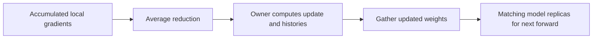

# Optimizing nanochat: AdamW, Muon, and distributed updates

The [pretraining note](nanochat-pretraining.md) followed a complete training run but treated the optimizer mostly as a box: accumulated gradients went in, updated weights came out. This note opens that box. We will learn Muon from the beginning, derive the transformations in this checkout, and then follow the communication that lets several GPUs perform the same logical update.

The source is nanochat commit `92d63d4e8bb4df75c3b71618f31ddde2378b2bcd`. Comparisons refer to your `transformer-from-scratch` at `56092a1818027c800f08167ec0c1c65b983711e1`. Precise line links refer to those checkouts. Neither repository needs to be modified to study the examples.

**How to skim:** every numbered section and subsection starts with a **Gist** paragraph. Read those first. They explain the question being answered and the result to retain; the equations and implementation details beneath them are a second reading layer. Sections 1–8 explain the update mathematics; sections 10–14 explain distribution. Section 9 connects the mathematics to model parameters.

This checkout combines the original Muon idea with several later modifications. We will distinguish the ideal polar-factor geometry, finite numerical approximations, empirical additions, and distributed bookkeeping. In particular, “Muon orthogonalizes updates” does not imply that its final update is exactly orthogonal or that its learned weight matrices become orthogonal.

## Contents

1. [What an optimizer receives and produces](#1-what-an-optimizer-receives-and-produces)
2. [AdamW as a familiar starting point](#2-adamw-as-a-familiar-starting-point)
3. [Muon from scratch: why treat a gradient as a matrix?](#3-muon-from-scratch-why-treat-a-gradient-as-a-matrix)
4. [Computing a polar factor without an SVD](#4-computing-a-polar-factor-without-an-svd)
5. [The actual Muon input: momentum and row balancing](#5-the-actual-muon-input-momentum-and-row-balancing)
6. [After the polar iteration: norm and adaptive scales](#6-after-the-polar-iteration-norm-and-adaptive-scales)
7. [Learning-rate shape correction and cautious decay](#7-learning-rate-shape-correction-and-cautious-decay)
8. [One complete Muon update](#8-one-complete-muon-update)
9. [Which model parameters receive which update](#9-which-model-parameters-receive-which-update)
10. [Distributed training: the three communication operations](#10-distributed-training-the-three-communication-operations)
11. [How AdamW work is divided across ranks](#11-how-adamw-work-is-divided-across-ranks)
12. [How Muon work is divided across ranks](#12-how-muon-work-is-divided-across-ranks)
13. [The three phases of optimizer.step](#13-the-three-phases-of-optimizerstep)
14. [Memory, numerical state, and checkpoint ownership](#14-memory-numerical-state-and-checkpoint-ownership)
15. [Comparison with your implementation](#15-comparison-with-your-implementation)
16. [Small experiments and questions](#16-small-experiments-and-questions)
17. [What to trust, what was checked, and where to read next](#17-what-to-trust-what-was-checked-and-where-to-read-next)

## 1. What an optimizer receives and produces

**Gist:** backward computes how the loss changes with each parameter. The optimizer chooses how to turn those derivatives into a parameter change, using both the current gradient and stored history. AdamW and Muon receive the same kind of mathematical input but construct different update directions.

### 1.1 The gradient is not yet the update

**Gist:** calling `.backward()` adds derivatives to `.grad`; calling `optimizer.step()` uses those derivatives to change the weights. Changing the optimizer changes this second operation, not the definition of the next-token loss.

Let a learned linear layer have weight matrix

$$
P\in\mathbb R^{m\times n},\qquad y=Px,
$$

where $m$ is output width and $n$ is input width. We use $P$ for one weight matrix throughout this note; $W$ will mean the number of distributed ranks. The matrix derivative has the same shape:

$$
G_t=\nabla_P\mathcal L_t\in\mathbb R^{m\times n}.
$$

Here $t=1,2,\ldots$ counts optimizer updates. This is one-based for moment bias corrections; it corresponds to training-loop index `step=t-1` in a fresh run. $G_t$ is a gradient matrix, distinct from the pretraining note's scalar $G$ for global token batch size.

Ordinary gradient descent would do $P_t=P_{t-1}-\eta G_t$. More generally,

$$
P_t=P_{t-1}-\eta_t H_t+\text{decay contribution},
$$

where $H_t$ is a direction constructed by the optimizer. Its dependence on current/previous gradients is what we are studying. Learning rate $\eta_t$ sets its scale.

### 1.2 The input is a globally averaged gradient

**Gist:** each rank accumulates local gradients first. Nanochat's optimizer averages them across ranks before applying AdamW or Muon. All nonlinear optimizer transformations belong after that averaging.

Recall $b$ sequences of length $T$ per local microbatch, $A$ accumulated microbatches, and $W$ processes. On rank $r$,

$$
G_t^{(r)}=\sum_{a=0}^{A-1}
\nabla_P\left(\mathcal L_{r,a}/A\right).
$$

The logical optimizer input is

$$
\overline G_t=\frac1W\sum_{r=0}^{W-1}G_t^{(r)}.
$$

For the single-matrix derivations below, write $G_t$ for this already averaged quantity. Sections 10–13 show where that average is actually computed. The script does not wrap GPT in PyTorch `DistributedDataParallel`; [MuonAdamW.step](../nanochat/nanochat/optim.py#L429) owns the synchronization.

## 2. AdamW as a familiar starting point

**Gist:** AdamW uses gradient history to choose a separate effective scale for each coordinate. Its two persistent arrays track gradients and squared gradients. Nanochat implements this familiar rule itself so it can combine it with Muon and distributed state ownership.

**Code:** [adamw_step_fused](../nanochat/nanochat/optim.py#L24).

### 2.1 First and second moments

**Gist:** the first moment smooths the gradient direction. The second moment estimates its recent squared magnitude, so persistently large-gradient coordinates receive a smaller adaptive multiplier.

Initialize $M_0=0$ and $V_0=0$, with both arrays shaped like $P$. Then

$$
M_t=\beta_1M_{t-1}+(1-\beta_1)G_t,
\qquad
V_t=\beta_2V_{t-1}+(1-\beta_2)G_t^{\odot2}.
$$

The symbol $\odot2$ means elementwise squaring, not matrix multiplication. Operations in this section, including division and square root, are coordinatewise.

Because both histories start at zero, early values are biased toward zero. For constant $G_t=G$, for example, $M_t=(1-\beta_1^t)G$. Adam corrects this initialization effect:

$$
\widehat M_t=\frac{M_t}{1-\beta_1^t},\qquad
\widehat V_t=\frac{V_t}{1-\beta_2^t},\qquad
H_t=\frac{\widehat M_t}{\sqrt{\widehat V_t}+\epsilon}.
$$

For a fresh first step with negligible epsilon, $H_{1,ij}\approx\mathrm{sign}(G_{1,ij})$. Later steps also depend on temporal consistency. This is coordinate adaptation, not the full inverse Hessian or a statistical variance calculation: $V$ is an uncentered second moment.

The source's `lerp_` is just an interpolation: `a.lerp_(b, w)` overwrites $a$ with $(1-w)a+wb$. Thus [these two calls](../nanochat/nanochat/optim.py#L51) implement exactly the moment recurrences.

### 2.2 The W in AdamW: decay outside the moments

**Gist:** AdamW shrinks the weights separately from its adaptive gradient direction. Adding an L2 penalty to the loss would also change the moment histories and generally gives a different algorithm.

Nanochat applies

$$
\boxed{P_t=(1-\eta_t\lambda)P_{t-1}-\eta_tH_t}.
$$

Its [kernel first shrinks the old parameter](../nanochat/nanochat/optim.py#L49), then adds the adaptive update. A loss penalty $\lambda\|P\|_F^2/2$ would instead replace $G_t$ by $G_t+\lambda P$ inside both moment recurrences. These operations need not agree under adaptive scaling. This is the distinction developed in the [AdamW paper](https://arxiv.org/abs/1711.05101).

For one coordinate with old value 2, $\eta=0.01$, $\lambda=0.1$, and adaptive direction $H=0.5$, the new value is $0.999\times2-0.01\times0.5=1.993$.

### 2.3 What “fused” changes

**Gist:** fusion changes how the update is executed, not its intended formula. The kernel combines the small tensor operations to reduce overhead, while explicitly using fp32 arithmetic before writing results back.

[The function](../nanochat/nanochat/optim.py#L23) has `torch.compile(dynamic=False, fullgraph=True)`. Its scalar settings are zero-dimensional CPU tensors populated by the caller, allowing their numerical values to change without making each value a new Python constant specialization.

The kernel casts parameters, gradients, and moments to fp32, computes the update, then copies results back to their original storage. **This does not mean all moment buffers are persistently fp32:** the [state allocation](../nanochat/nanochat/optim.py#L340) uses `zeros_like(p_slice)`. If a table is stored in BF16, its stored moments are BF16 too, with fp32 arithmetic inside this function. The efficiency note will discuss the numerical implications.

## 3. Muon from scratch: why treat a gradient as a matrix?

**Gist:** a linear layer's gradient has matrix structure: it couples input directions to output directions. Muon's central idea is to flatten the singular-value spectrum of a momentum-derived update, instead of only adapting coordinates independently. This changes the geometry of the proposed update.

The name expands to **MomentUm Orthogonalized by Newton–Schulz**. The original [author's explanation](https://kellerjordan.github.io/posts/muon/) introduces the hidden-layer optimizer. Nanochat uses a modified implementation, so we derive the actual code below rather than substituting the original algorithm for it.

### 3.1 What is being orthogonalized?

**Gist:** the object being approximately orthogonalized is the proposed change to a weight matrix. The weights themselves remain unconstrained, and the model's forward pass acquires no orthogonal-weight constraint.

For a single example $y=Px$ with loss derivative $\delta=\partial\mathcal L/\partial y$,

$$
\frac{\partial\mathcal L}{\partial P}=\delta x^\top.
$$

A batch gradient is a sum of such outer products. Its dominant directions need not align with individual coordinates of $P$. Singular values describe the strengths of these coupled input/output directions.

Let $B$ be a momentum-derived matrix and take a thin SVD, initially assuming full rank $q=\min(m,n)$:

$$
B=U\Sigma V^\top,\qquad
U\in\mathbb R^{m\times q},\quad V\in\mathbb R^{n\times q}.
$$

If $\Sigma=\mathrm{diag}(100,1)$, the update emphasizes one singular direction 100 times more strongly. The ideal polar-factor replacement is

$$
\boxed{Q=UV^\top},
$$

so the two nonzero singular values become 1 and 1. This does not prove the weaker direction is useful; it explains the transformation. Its benefit for language-model optimization is empirical.

### 3.2 Rectangular matrices are semi-orthogonal

**Gist:** a rectangular matrix cannot generally have both orthonormal rows and orthonormal columns. Its polar factor has orthonormal vectors on the smaller side, and Frobenius norm $\sqrt{\min(m,n)}$.

For full-rank $B$,

$$
\begin{cases}
Q^\top Q=I_n,&m\ge n\quad\text{(tall or square)},\\
QQ^\top=I_m,&m\le n\quad\text{(wide or square)}.
\end{cases}
$$

The other product is a projection when the matrix is genuinely rectangular. Since $q$ singular values equal one,

$$
\|Q\|_F^2=q.
$$

For $m\ge n$ one can also write $Q=B(B^\top B)^{-1/2}$; for $m\le n$, $Q=(BB^\top)^{-1/2}B$. These identities reveal a matrix preconditioning interpretation, but the code computes neither an explicit inverse nor an SVD.

### 3.3 Why the polar factor is a natural direction

**Gist:** the polar factor is the nearest semi-orthogonal matrix to a full-rank input. It also maximizes first-order improvement under a bound on the update's operator norm. That is a useful geometric motivation, not a guarantee about finite-step neural-network training.

First, consider matrices $Q$ with the appropriate orthonormal rows or columns. They all have $\|Q\|_F^2=q$. Therefore

$$
\|B-Q\|_F^2=\|B\|_F^2+q-2\langle B,Q\rangle_F,
$$

where $\langle B,Q\rangle_F=\mathrm{tr}(B^\top Q)$. Minimizing distance is equivalent to maximizing this inner product; $Q=UV^\top$ attains $\sum_i\sigma_i(B)$.

There is also a local descent interpretation. Linearizing a loss gives

$$
\mathcal L(P-\eta H)\approx\mathcal L(P)-\eta\langle G,H\rangle_F.
$$

Under $\|H\|_2\le1$, where $\|\cdot\|_2$ is the largest singular value, each $u_i^\top Hv_i\le1$. Hence

$$
\langle G,H\rangle_F\le\sum_i\sigma_i(G),
$$

and the gradient's polar factor attains the bound. This is steepest descent for an operator-norm constraint; Euclidean steepest descent instead constrains the Frobenius norm and chooses a direction proportional to $G$.

Actual Muon uses momentum, input balancing, a finite polynomial, and subsequent rescaling. The ideal argument explains a design choice; it is not a proof that the final direction maximizes the current loss decrease. It does not use a Hessian.

### 3.4 Rank deficiency and very small singular values

**Gist:** the polar ideal requires care when the input is rank deficient. A polynomial can amplify small nonzero singular directions, but cannot invent directions corresponding to exactly zero singular values.

If $B$ has rank $r<q$, its canonical partial polar factor is $U_rV_r^\top$ and has rank $r$. A nearest fully semi-orthogonal matrix can complete the missing directions, but the completion is nonunique. The polynomial in the source contains no such completion: an exact zero singular value remains zero in exact arithmetic.

Thus statements such as “all singular values become one” assume a full-rank ideal input and sufficiently accurate evaluation. A five-step computation need not closely resolve extremely small nonzero singular values either. The later norm correction rescales what is present; it does not restore missing rank.

## 4. Computing a polar factor without an SVD

**Gist:** computing an SVD at every update would be expensive. Muon instead transforms singular values indirectly through a short sequence of matrix multiplications. Nanochat uses five stage-dependent quintic polynomials from Polar Express.

**Code:** [coefficient table](../nanochat/nanochat/optim.py#L102), [normalization and polynomial loop](../nanochat/nanochat/optim.py#L144).

### 4.1 How a matrix polynomial changes singular values

**Gist:** multiplication by a polynomial of a Gram matrix changes singular-value magnitudes while preserving the corresponding singular-vector bases in exact arithmetic. This lets us approximate the polar map using GPU-friendly matrix products.

For a wide matrix $X=U\Sigma V^\top$, consider

$$
X_{new}=aX+b(XX^\top)X+c(XX^\top)^2X.
$$

Substituting the SVD gives

$$
X_{new}=U\left(a\Sigma+b\Sigma^3+c\Sigma^5\right)V^\top.
$$

Each singular component therefore follows the scalar polynomial

$$
f(\sigma)=a\sigma+b\sigma^3+c\sigma^5.
$$

If $f$ maps the relevant positive values near one, the matrix becomes approximately semi-orthogonal. More precisely, the signed factors are $f(\sigma)$; their absolute values are singular values if a polynomial crosses zero. This is why the coefficient choice and input range matter.

For orientation, the classical cubic Newton–Schulz update uses $f(\sigma)=\tfrac32\sigma-\tfrac12\sigma^3$. It fixes 1 and has derivative zero there. **Nanochat does not use that cubic:** its stage-dependent quintics aim to move an entire interval of singular values efficiently in a small fixed budget. See the [Polar Express paper](https://arxiv.org/abs/2505.16932) for the polynomial-design problem.

### 4.2 Normalize once, then take five specific steps

**Gist:** the iteration expects a controlled input scale. Nanochat divides by a slightly enlarged Frobenius norm, then applies a fixed five-entry coefficient schedule. Increasing an iteration counter does not generate arbitrarily many refinement steps.

Given its balanced input $R$ (constructed in section 5), it initializes

$$
X_0=\frac{R}{1.01\|R\|_F+10^{-6}}.
$$

Since $\|R\|_2\le\|R\|_F$, this places the largest singular value below one for nonzero finite inputs in exact arithmetic. The safety factor and epsilon provide margin and avoid division by zero.

The source coefficients, rounded here for readability, are:

| Stage | $a$ | $b$ | $c$ |
| ---: | ---: | ---: | ---: |
| 1 | 8.156555 | −22.483293 | 15.878770 |
| 2 | 4.042930 | −2.808917 | 0.500018 |
| 3 | 3.891668 | −2.772484 | 0.506065 |
| 4 | 3.285754 | −2.368129 | 0.464490 |
| 5 | 2.346541 | −1.709783 | 0.423236 |

Use the full constants from the file for numerical checks. These stages were designed together; repeatedly applying one row is a different algorithm. The group setting is `ns_steps=5`, a historical name retained for the polar iteration. The code uses `polar_express_coeffs[:ns_steps]`: requesting more than five still takes only these five entries.

The result is an approximation, with error depending on spectrum and floating-point arithmetic. The old source preamble describing a broad singular-value band for a fixed quintic is background, not a quantitative error guarantee for this coefficient schedule.

### 4.3 Tall versus wide: choose the smaller Gram matrix

**Gist:** the two branches implement the same singular-value polynomial. They differ in whether the square intermediate has dimension $m$ or $n$, choosing the smaller one to reduce work and temporary storage.

The actual operations are

$$
\begin{array}{ll}
m>n:& A=X^\top X,\quad B=bA+cA^2,\quad X\leftarrow aX+XB,\\
m\le n:& A=XX^\top,\quad B=bA+cA^2,\quad X\leftarrow aX+BX.
\end{array}
$$

For an MLP up projection with shape $(3072,768)$, $X^\top X$ is only $(768,768)$ rather than $(3072,3072)$. The down projection with shape $(768,3072)$ uses $XX^\top$, again $(768,768)$.

Groups are stacked as $(J,m,n)$, where $J$ counts same-shaped parameter matrices. PyTorch's batched products apply the procedure independently to each matrix. Norms use dimensions `(-2,-1)`, so a large matrix in the stack does not set a common norm for all the others.

### 4.4 How much work does the polynomial add?

**Gist:** Muon's update is more expensive than a coordinatewise AdamW update, but the matrix polynomial runs once per optimizer step, not once per training token. Its benefit must be assessed by time to a target loss or capability, including that extra work.

Let $q=\min(m,n)$. In each polynomial stage, forming the smaller Gram matrix costs approximately $2mnq$ FLOPs, squaring it costs $2q^3$, and multiplying the correction by $X$ costs another $2mnq$. Ignoring elementwise operations, that is

$$
C_{polar,stage}\approx4mnq+2q^3
$$

per matrix, repeated five times by default. Its matrix-product cost is independent of how many training tokens contributed to the accumulated gradient. By contrast, that layer's forward/backward products scale approximately as $6mn$ times its processed token count. The owner/rank arrangement later determines where the optimizer work runs.

This estimate explains why matrix dimensions, iteration count, batching, and ownership matter. It does not prove Muon is faster overall: a more expensive update can be worthwhile if it reaches a target with sufficiently less training, which requires measurement. The pretraining script's model-FLOP estimate does not include this optimizer work.

## 5. The actual Muon input: momentum and row balancing

**Gist:** the polar iteration is not applied directly to a raw local gradient. Its input comes from globally averaged gradients, an EMA/Nesterov-style combination, and row equilibration. We now follow those preprocessing steps exactly.

**Code:** [momentum](../nanochat/nanochat/optim.py#L130), [row equilibration](../nanochat/nanochat/optim.py#L138).

### 5.1 The source's momentum convention

**Gist:** nanochat stores an exponential moving average of gradients, then blends it with the current gradient again. Its normalized momentum convention differs in scale from the textbook unnormalized velocity recurrence, so read the equations rather than relying on the word “Nesterov.”

With zero-initialized buffer $M_0$, the two in-place interpolations implement

$$
M_t=\mu_tM_{t-1}+(1-\mu_t)G_t,
\qquad
B_t=(1-\mu_t)G_t+\mu_tM_t.
$$

For a fresh first update at $\mu=0.95$,

$$
M_1=0.05G_1,\qquad B_1=0.0975G_1.
$$

There is no Adam-style moment bias correction here. Subsequent norm normalization largely removes a common positive magnitude factor, but the history-dependent matrix direction still matters. Epsilons and finite precision mean global rescaling is not perfectly invisible in every case.

The call `stacked_grads.lerp_(momentum_buffer, momentum)` overwrites the reduced gradient work buffer with $B_t$. The persistent momentum buffer separately retains $M_t$. Schedules for $\mu_t$ are explained in the pretraining note.

### 5.2 Equalize row norms before the finite iteration

**Gist:** rows with very different norms can give the finite polar iteration a difficult input. Nanochat rescales each nonzero row toward a shared target, while preserving the matrix's overall Frobenius norm when clamps are inactive. This is an extra transformation, not part of the definition of a polar factor.

After an optional cast to BF16, let $B$ denote the working matrix. Define

$$
\tau=\frac{\|B\|_F}{\sqrt m},\qquad
r_i=\max(\|B_{i,:}\|_2,10^{-6}),\qquad
R_{i,:}=B_{i,:}\frac{\tau}{r_i}.
$$

For nonzero unclamped rows, $\|R_{i,:}\|_2=\tau$ and

$$
\|R\|_F^2=m\tau^2=\|B\|_F^2.
$$

The target is the **root mean square of row norms**, not their arithmetic mean, despite the source comment's shorthand. For row norms 3 and 1, the common target is $\sqrt{(9+1)/2}=\sqrt5$, not 2.

Row scaling changes the input geometry: in general $\mathrm{polar}(R)\ne\mathrm{polar}(B)$. It can rebalance scales, but is not guaranteed to reduce every matrix's condition number. Zero rows remain zero; clamped tiny rows do not exactly reach the target.

The source calls this MuonEq row equilibration. The cited [MuonEq work](https://arxiv.org/abs/2603.28254) studies preprocessing before finite orthogonalization. We use the local equations above as the specification of the variant actually present here.

### 5.3 Precision at the polar boundary

**Gist:** the matrix polynomial may execute in BF16 for speed even when stored weights and momentum are fp32. The norm calculations and casts are part of the implementation, so exact identities should be understood as real-arithmetic targets.

The source sets `X = g.bfloat16()` only when `COMPUTE_DTYPE` is BF16; otherwise it leaves this cast out. Row-norm statistics explicitly use fp32, while the polynomial's working tensors and matmuls follow `X`'s dtype. The result is cast back to the parameter dtype before the later transformations.

The code avoids an explicit FP16 cast at this point because of its narrower exponent range. This is a reason for its local policy, not a claim that every optimizer quantity is always high precision. Detailed format/range analysis belongs in the next efficiency note.

## 6. After the polar iteration: norm and adaptive scales

**Gist:** a finite polar computation may have the wrong total magnitude and unequal row/column scales. Nanochat first fixes the total norm, then uses a small history buffer to redistribute update magnitude across rows or columns while retaining that total norm approximately.

**Code:** [Frobenius correction](../nanochat/nanochat/optim.py#L158), [factored adaptation](../nanochat/nanochat/optim.py#L163).

### 6.1 Correct the total norm

**Gist:** an exact full-rank polar factor has Frobenius norm $\sqrt q$, where $q=\min(m,n)$. The code scales its finite approximation to that norm. A correct norm alone does not make a matrix orthogonal.

Write $Z$ for the polynomial result after casting back to parameter dtype. The next operation is

$$
Z\leftarrow Z\frac{\sqrt q}{\max(\|Z\|_F,10^{-6})}.
$$

For nonzero $Z$ above the clamp, this makes $\|Z\|_F=\sqrt q$ in exact arithmetic. It corrects aggregate scale even if individual singular values have not all reached one. For example, singular values $\sqrt{1.8}$ and $\sqrt{0.2}$ already have squared sum 2, yet their ratio is 3 rather than 1.

The source calls this “Muon+ renormalization” and cites [Muon+](https://arxiv.org/abs/2602.21545). That paper studies additional post-polar normalization; the scalar Frobenius correction here should not be identified with every row/column normalization variant in the paper. The local function defines the behavior we study.

For a rank-deficient input, this step still targets $\sqrt q$ rather than $\sqrt{\mathrm{rank}(Z)}$. It scales existing nonzero directions more strongly and does not fill null directions. A completely zero matrix stays zero.

### 6.2 A small second-moment buffer instead of Adam's full array

**Gist:** nanochat tracks the squared update size for each row of a tall/square matrix, or each column of a wide matrix. This needs only $\max(m,n)$ numbers per matrix, rather than the $mn$ second-moment numbers Adam uses.

The ownership code chooses the [reduction dimension](../nanochat/nanochat/optim.py#L383) and associated buffer shape:

| Weight shape | Squared-magnitude statistic | Stored buffer shape | `red_dim` |
| --- | --- | --- | --- |
| $m\ge n$ | $s_i=\frac1n\sum_j Z_{ij}^2$ per row | $(m,1)$ | −1 |
| $m<n$ | $s_j=\frac1m\sum_i Z_{ij}^2$ per column | $(1,n)$ | −2 |

The leading stack dimension is omitted here; each owned matrix has its own statistics. Square matrices take the row-statistic branch, even though the polar loop's square case uses $XX^\top$.

With $v_0=0$ and the group's default $\beta_2=0.9$,

$$
v_t=\beta_2v_{t-1}+(1-\beta_2)s_t,\qquad
d_i=\frac1{\sqrt{\max(v_{t,i},10^{-10})}}.
$$

Broadcast $d_i$ across the associated row or column. Notice what enters this second moment: the **post-polar, norm-corrected update $Z$**, not the raw gradient $G_t$. This is a NorMuon-style adaptation; the [NorMuon paper](https://arxiv.org/abs/2510.05491) motivates combining a matrix transformation with neuron-level adaptive scales. Nanochat's orientation and norm convention are specified by its own code.

The term “variance reduction” in the source is shorthand. There is no subtraction of a mean to compute a centered statistical variance. Likewise, this is not two-sided matrix factorization of Adam's full second moment: it stores one row- or column-wise vector.

### 6.3 Adapt relative scales, then restore total size

**Gist:** inverse-root second moments determine which rows/columns get relatively larger updates. A final scalar normalization removes the change in total Frobenius norm, so the learning rate continues to control overall update size.

Let $\widetilde H$ be $Z$ multiplied by the broadcast adaptive scales. For the tall case,

$$
\widetilde H_{ij}=d_iZ_{ij}.
$$

The wide case instead uses $d_jZ_{ij}$. The effective result is

$$
\boxed{H=\widetilde H\frac{\|Z\|_F}{\max(\|\widetilde H\|_F,10^{-10})}}.
$$

For ordinary nonzero values with inactive clamps, $\|H\|_F=\|Z\|_F=\sqrt q$. The implementation obtains these norms from the per-channel statistics rather than storing another full matrix. If $k$ is the number of entries per reduced channel ($k=n$ for rows, $k=m$ for columns),

$$
\|Z\|_F^2=k\sum_i s_i,
\qquad
\|\widetilde H\|_F^2=k\sum_i s_id_i^2.
$$

This explains `v_norm`, `scaled_sq_sum`, `v_norm_new`, and `final_scale` in the kernel.

There is no explicit Adam-style bias correction for $v$. With constant $\beta_2$, dividing all its entries by the same bias factor would multiply every $d_i$ by a common scalar, which cancels in the final norm restoration when clamps/rounding are ignored. Relative channel histories still affect $H$.

### 6.4 Which properties survive the full transformation?

**Gist:** the intended total norm survives the channel adaptation, but exact semi-orthogonality generally does not. It is more accurate to describe the final direction as derived from a polar iteration than to call it an exact polar factor.

Left or right multiplication by a nonuniform diagonal scaling generally changes singular vectors and singular values. Restoring one global norm cannot undo those changes. Input row equilibration also changed the matrix whose polar factor was being approximated.

For a concrete example, start with the exactly column-orthonormal matrix

$$
Z=\begin{pmatrix}1&0\\0&1/\sqrt2\\0&1/\sqrt2\end{pmatrix},
\qquad Z^\top Z=I_2.
$$

At the first unclamped adaptive step, row normalization followed by restoration to norm $\sqrt2$ yields

$$
H=\sqrt{2/3}
\begin{pmatrix}1&0\\0&1\\0&1\end{pmatrix},
\qquad
H^\top H=\mathrm{diag}(2/3,4/3).
$$

The norm is still $\sqrt2$, but the two singular values are different. That is compatible with the code's intended combination of matrix geometry and adaptive scales.

## 7. Learning-rate shape correction and cautious decay

**Gist:** after choosing an update direction, we still need its numerical scale and a decay rule. Nanochat boosts the LR of tall matrices and applies decay only where its sign test permits it. These are separate operations from the polar polynomial.

### 7.1 Why tall matrices receive an LR multiplier

**Gist:** a norm-$\sqrt{\min(m,n)}$ matrix has an entrywise RMS that depends on shape. Nanochat's multiplier makes the gradient-driven update RMS scale approximately as the group LR divided by the square root of input width.

**Code:** [effective Muon LR](../nanochat/nanochat/optim.py#L393).

The scheduled group LR $\eta$ is changed to

$$
\eta_{eff}=\eta\sqrt{\max(1,m/n)}.
$$

If $\|H\|_F\approx\sqrt{\min(m,n)}$, then

$$
\mathrm{RMS}(H)=\frac{\|H\|_F}{\sqrt{mn}}
\approx\frac1{\sqrt{\max(m,n)}},
$$

and hence

$$
\mathrm{RMS}(\eta_{eff}H)\approx\frac\eta{\sqrt n}.
$$

For a transformer MLP up projection $(4d,d)$, the multiplier is 2. For its down projection $(d,4d)$, it is 1. This is a shape-based scale convention, not a theorem that these settings are optimal. Nanochat's [experiment reversing this heuristic](../nanochat/dev/LOG.md#L299) did not lead to adopting the reversed version.

### 7.2 Cautious weight decay, coordinate by coordinate

**Gist:** normal decay always pulls a nonzero weight toward zero. This kernel enables that pull only when the transformed update is not pointing away from zero. The sign check uses the final adapted direction $H$, not the raw gradient.

**Code:** [mask and parameter update](../nanochat/nanochat/optim.py#L179).

For each coordinate,

$$
c_{ij}=\mathbf1[H_{ij}P_{ij}\ge0],
\qquad
\boxed{P_{ij}\leftarrow P_{ij}
-\eta_{eff}\left(H_{ij}+\lambda P_{ij}c_{ij}\right)}.
$$

If $P_{ij}>0$ and $H_{ij}>0$, subtracting $H_{ij}$ points toward zero and decay also acts. If $P_{ij}<0$ and $H_{ij}>0$, subtracting $H_{ij}$ points away from zero and decay is suppressed. The analogous cases hold for negative $H$.

For $P=[2,-2]$, $H=[1,1]$, $\eta_{eff}=0.1$, and $\lambda=0.2$, the mask is $[1,0]$ and

$$
P_{new}=[2-0.1(1+0.4),\ -2-0.1]=[1.86,-2.1].
$$

The non-strict comparison matters: when $H_{ij}=0$, the mask is 1, so decay may still change a nonzero parameter. Even a completely zero gradient/update does not imply unchanged parameters if decay is enabled.

The shape-adjusted $\eta_{eff}$ multiplies both direction and decay. The pretraining script supplies a scaled, cosine-scheduled $\lambda$ to Muon groups; AdamW groups retain their own fixed coefficients. The pretraining note's simple cumulative-decay derivation was a motivation, not an exact invariant of this sign-dependent rule.

## 8. One complete Muon update

**Gist:** the logical chain is averaged gradient → momentum → row equilibration → approximate polar factor → norm correction → adaptive row/column scales → shaped LR and cautious decay. No single word such as “orthogonalization” describes every stage.

For each owned matrix, the sequence in [muon_step_fused](../nanochat/nanochat/optim.py#L112) and its caller is:

| Stage | Input → output | Persistent history changed? |
| --- | --- | --- |
| EMA/Nesterov-style blend | $G_t,M_{t-1}\to M_t,B_t$ | Full momentum matrix $M_t$ |
| Optional compute cast | $B_t\to$ working dtype | No |
| Row equilibration | $B_t\to R_t$ | No |
| Normalize and five polar steps | $R_t\to X_5$ | No |
| Cast back and Frobenius correction | $X_5\to Z_t$ | No |
| Channel adaptation and norm restoration | $Z_t,v_{t-1}\to H_t,v_t$ | Row/column second moment $v_t$ |
| Effective LR and masked decay | $P_{t-1},H_t\to P_t$ | Weights $P_t$ |

The momentum buffer stores the EMA **before** the polar transformation; it is not overwritten with $H_t$. The second-moment buffer summarizes $Z_t^{\odot2}$ in the chosen channels. Neither buffer is an activation in the model's forward pass.

This distinction helps explain memory and checkpoints: the model's weights are not the entire training state. To perform the same next update, we also need the owned histories and current settings.

## 9. Which model parameters receive which update

**Gist:** nanochat mixes two algorithms inside one optimizer object. Hidden projection matrices, including the small value gates, use Muon. Embedding tables, output head, and global coefficients use AdamW—even when a parameter has two dimensions.

**Code:** [GPT.setup_optimizer](../nanochat/nanochat/gpt.py#L419).

| Parameters | Algorithm | Why distinguish them here? |
| --- | --- | --- |
| All tensors in transformer blocks | Muon | Matrix-update geometry of hidden projections |
| Main token embedding and value tables | AdamW | Indexed table parameters; chosen separate treatment |
| Output head | AdamW | Classifier/readout with its own tuned dynamics |
| Residual/input coefficients | AdamW | Vector parameters, not hidden linear maps |
| Smear gate, smear coefficient, backout coefficient | AdamW | Explicit global group, including a small matrix |

The source assigns by model role, not just `p.ndim == 2`. The table records a design choice; there is no dimensional impossibility preventing an alternative experiment on a table or readout. It would be a different optimizer configuration.

Muon parameters are additionally [grouped by equal shape](../nanochat/nanochat/gpt.py#L447) so that they can be stacked for batched matrix operations and communication. A $(d,d)$ group may contain tensors from different layers and projection roles. They remain independently transformed matrices; stacking does not orthogonalize one combined giant layer.

Group LRs, beta values, width/batch multipliers, and schedules were tabulated in sections 8–10 of the pretraining note. Those settings are applied to the algorithms just derived. `momentum=0.95` in group construction is not a constant for the full pretraining run: the training loop overwrites it according to its momentum schedule before each update.

## 10. Distributed training: the three communication operations

**Gist:** every GPU starts a step with the same weights but different local data. We need to average gradients, divide update work and history storage, then make every rank's weights agree again. Three collective operations provide these pieces.

Here a **rank** is one training process, usually one GPU; $W$ is the number of ranks. A **collective** is an operation that the participating processes invoke together. The mathematical descriptions below match the operations documented by [PyTorch](https://docs.pytorch.org/docs/2.9/distributed.html).

### 10.1 All-reduce: everybody receives the same average

**Gist:** all-reduce combines matching gradient entries from all ranks and leaves the complete result on every rank. Nanochat uses an average, so there is no additional division by world size in the loss.

For two ranks with local vectors

```text
rank 0: [1, 3, 5, 7]
rank 1: [3, 5, 7, 9]
```

an average all-reduce leaves `[2, 4, 6, 8]` on both ranks. “Reduce” combines values; “all” means every participant gets the result. This is the source's path for small AdamW parameters.

### 10.2 Reduce-scatter: average, then keep only an owned piece

**Gist:** reduce-scatter computes the same global reduction but distributes pieces of its result. Each rank gets the averaged gradient only for the part it will update.

With the same two local vectors, average reduce-scatter gives

```text
rank 0 receives [2, 4]
rank 1 receives [6, 8]
```

The first piece includes contributions from **both ranks**; rank 0 does not simply keep its own local gradient. The source uses this to avoid computing and storing every optimizer history on every GPU.

The piece boundaries differ by algorithm: AdamW splits rows of one tensor, whereas Muon splits a stack of complete matrices. That difference is central to the next two sections.

### 10.3 All-gather: distribute the newly updated weights

**Gist:** after each owner updates its piece, all-gather assembles all the pieces on every rank. Here it communicates updated parameters, rather than recomputing their updates everywhere.

For a simple SGD illustration, let the shared old parameter vector be `[10, 20, 30, 40]` and LR be 0.1. Using the reduced gradient pieces above:

```text
rank 0 updates its piece to [9.8, 19.6]
rank 1 updates its piece to [29.4, 39.2]
all-gather leaves [9.8, 19.6, 29.4, 39.2] on both ranks
```

AdamW and Muon use their own formulas in the middle, but the data movement has this structure. An owner is responsible for computing an update and keeping its history; it is not the only process that retains those model weights for the next forward pass.

### 10.4 Why average before the nonlinear optimizer transformation?

**Gist:** transforming each local gradient and averaging the resulting directions generally gives a different answer. Nanochat first forms the averaged gradient so distributed execution represents one global-batch optimizer update.

For example, take two gradient matrices

$$
G^{(0)}=\mathrm{diag}(2,0.1),\qquad
G^{(1)}=\mathrm{diag}(-1,0.1).
$$

Their average is $\mathrm{diag}(0.5,0.1)$, whose exact polar factor is $I$. But the average of their polar factors is

$$
\tfrac12\left[I+\mathrm{diag}(-1,1)\right]
=\mathrm{diag}(0,1).
$$

Thus $\mathrm{polar}(\mathrm{mean}G)\ne\mathrm{mean}(\mathrm{polar}G)$. Adam's adaptive denominator and persistent moment histories also require consistent global inputs. Assigning owners changes where the intended update is computed, not which local objective it represents.

## 11. How AdamW work is divided across ranks

**Gist:** AdamW's coordinatewise formulas let different ranks update different rows independently once each has the globally averaged gradient for its rows. Very small tensors instead use replicated histories because the simple all-reduce path is adequate for them.

**Code:** [_reduce_adamw](../nanochat/nanochat/optim.py#L274), [_compute_adamw](../nanochat/nanochat/optim.py#L320).

### 11.1 Small tensors: all ranks perform the whole update

**Gist:** a tensor with fewer than 1024 elements gets an average all-reduce, then each rank updates the complete tensor using its own matching moment histories. These small histories are replicated.

The threshold is based on `p.numel()`, not tensor rank or model role. For a 24-element vector and eight ranks, all eight receive the same averaged gradient, retain 24-element first and second moments, and compute the same update. No subsequent all-gather is needed for that tensor.

This path assumes identical starting parameters, histories, and hyperparameters. Identical reduced gradients then keep the replicas consistent up to the numerical execution used.

### 11.2 Large tensors: split along the first dimension

**Gist:** a large AdamW tensor is split into contiguous row slices. Each rank stores moments and computes the update only for its own rows, then all-gather restores the complete weights everywhere.

For example, take a $(1024,8)$ tensor and $W=2$:

| Rank | Owned rows | Gradient slice | First moment | Second moment |
| --- | --- | --- | --- | --- |
| 0 | 0–511 | $(512,8)$ | $(512,8)$ | $(512,8)$ |
| 1 | 512–1023 | $(512,8)$ | $(512,8)$ | $(512,8)$ |

Each still holds the full $(1024,8)$ model parameter for forward/backward. After reduce-scatter, rank 0 updates the first half of that parameter using the first-half global gradient and its own histories. Rank 1 updates the other half. All-gather fills the remaining rows on each rank.

This is mathematically compatible with full-tensor AdamW because its update for one coordinate does not require another row's gradient or moments. Each coordinate's complete history stays with one owner.

The source asserts `p.shape[0] % world_size == 0`. Large-tensor rows are not padded by this AdamW path. A world size incompatible with a table's row count causes an assertion rather than automatic resharding or uneven slices.

### 11.3 Single-rank behavior

**Gist:** on one GPU/process, no collective is necessary. Every AdamW parameter uses its full tensor and full moments, including large tables.

The `world_size == 1` branch labels the tensor `is_small=True` to reuse the full-tensor code path. That internal flag then means “operate on the full parameter,” not literally that its element count is below 1024.

The distinction matters when reading state shapes: a large table's saved optimizer state is a full table on one rank but a row slice in a compatible multi-rank run.

## 12. How Muon work is divided across ranks

**Gist:** Muon's matrix polynomial needs a complete matrix, so the optimizer distributes whole matrices rather than independent row slices. Equal-shaped matrices are stacked, averaged, assigned to owners, updated, and gathered back.

**Code:** [_reduce_muon](../nanochat/nanochat/optim.py#L295), [_compute_muon](../nanochat/nanochat/optim.py#L362), [_finish_gathers](../nanochat/nanochat/optim.py#L419).

### 12.1 Why not use the same row partition as AdamW?

**Gist:** a row's Muon update depends on other rows and columns through the Gram matrix and normalizations. Orthogonalizing isolated row chunks would implement a different transformation from orthogonalizing the whole matrix.

For example, $X^\top X=\sum_i X_{i,:}^\top X_{i,:}$ depends on all rows. For a wide matrix, $XX^\top$ directly contains interactions between different rows. The complete update also uses matrix-wide norms.

It is possible to design other distributed algorithms that communicate those dependencies, but this checkout chooses a simpler approach: one rank owns the full update calculation for each assigned matrix. Other ranks do not need its momentum history to perform their own forward passes.

### 12.2 Stack, pad, and assign whole matrices

**Gist:** group size need not be divisible by world size. Muon pads the stack with zero dummy matrices, gives each rank an equally sized chunk, and ignores dummy entries when copying results back.

Let a group contain $J$ matrices of the same shape $(m,n)$. Then

$$
c=\left\lceil\frac JW\right\rceil,
\qquad J_{pad}=cW.
$$

Here $c$ counts stack entries assigned to each rank; it is not a matrix row count. Each rank stacks its locally accumulated gradients as $(J,m,n)$, pads to $(J_{pad},m,n)$, then participates in average reduce-scatter. The output is $(c,m,n)$.

For $J=5$ matrices and $W=3$, $c=2$ and $J_{pad}=6$:

| Owner | Stack indices | Real matrices updated |
| --- | --- | --- |
| Rank 0 | 0, 1 | Matrices 0 and 1 |
| Rank 1 | 2, 3 | Matrices 2 and 3 |
| Rank 2 | 4, 5 | Matrix 4; index 5 is padding |

Every real owned gradient already averages contributions from all three ranks. It is not just the owner's local gradient.

The caller computes `num_owned` and invokes the fused kernel only for actual matrices. State buffers include $c$ slots, but padded slots do not drive a real parameter update. When $J<W$, some ranks can own no real matrix in that group and still participate in communication.

### 12.3 Owner histories and reconstruction

**Gist:** the owner retains full momentum and the factored second moment for its matrices. It gathers updated matrix values back to all ranks, which copy those values into their separate model parameters.

For each owned $(m,n)$ matrix, the owner stores $mn$ momentum entries and $\max(m,n)$ second-moment entries. The group-level state is attached to the group's first parameter as a dictionary key; that key does not mean the state describes only that first matrix. The leading state dimension spans the owner's chunk.

The code stacks owned parameter values into a temporary tensor and updates it. It then all-gathers updated chunks, including zero placeholders for padding. `_finish_gathers` copies the first $J$ entries back into the individual model parameters with `torch._foreach_copy_`.

The earlier full stacked-gradient buffer is reused as the all-gather destination after reduction has completed and gradients are no longer needed there. This is a lifetime-based memory reuse; the data in that storage changes meaning from gradients to updated parameters.

On one rank, all matrices belong to that rank, reduce-scatter/all-gather are skipped, and the temporary updated stack is copied directly back.

## 13. The three phases of optimizer.step

**Gist:** nanochat starts reductions for all groups, then computes updates as their gradients become available and starts gathers, then waits for all gathered weights. This creates opportunities to overlap communication and computation while preserving the required dependencies.

**Code:** [phase 1](../nanochat/nanochat/optim.py#L438), [phase 2](../nanochat/nanochat/optim.py#L448), [phase 3](../nanochat/nanochat/optim.py#L458).

### 13.1 Launch reductions before computing updates

**Gist:** launching an asynchronous collective returns a handle rather than blocking Python until the data is ready. The optimizer can launch work for other groups before waiting for any one group.

The first pass over parameter groups calls `_reduce_adamw` or `_reduce_muon`. The returned dictionaries include communication futures and output buffers. Those buffers must not be consumed for updates before their futures are ready.

All ranks must execute compatible collective calls in a consistent order. The parameter groups and ownership layout are part of the distributed algorithm, not arbitrary per-rank choices.

### 13.2 Wait, compute owned updates, launch gathers

**Gist:** a group's update starts only after its reduced gradient is available. Its updated values can then be gathered while later groups are being processed.

The second pass waits on the relevant reduction future, applies AdamW or Muon to the owned data, and launches the needed all-gather. The small AdamW path performs no gather because every rank already computed matching complete weights.

Conceptually the dependencies are:



Independent groups can be in different stages of that chain. Actual overlap depends on device streams, backend, tensor sizes, hardware, and scheduling; `async_op=True` alone does not promise a particular speedup.

### 13.3 Finish before the next model forward

**Gist:** `step()` returns only after the gathers have been waited on and Muon stacks copied back. The next training forward uses the completed parameter update, not a mixture of old and new owners' values.

This source processes groups in their fixed order; it is not a general scheduler that dynamically picks whichever group finishes first. The phase structure simply gives the runtime more room to overlap work than a strict reduce/update/gather/wait sequence for each group.

The method is under `@torch.no_grad()`: optimizer arithmetic does not build a differentiable graph of its own. Gradients are cleared by the training script afterward, separately from the optimizer's persistent histories.

## 14. Memory, numerical state, and checkpoint ownership

**Gist:** sharding saves persistent optimizer-state memory and divides update computation, but this trainer still holds replicated model weights and full local accumulated gradients. Temporary stacks and Gram matrices also consume memory. “Distributed optimizer” does not mean every large allocation has been divided by world size.

### 14.1 Count entries before converting to bytes

**Gist:** AdamW keeps two full coordinate histories for the portion it owns. Muon keeps one full matrix history plus a much smaller channel history. Multiply those entry counts by the actual stored dtype's bytes, not an assumed universal fp32 size.

For one $(m,n)$ matrix/table:

| History | AdamW, full tensor | Muon, full matrix |
| --- | ---: | ---: |
| First moment / momentum | $mn$ | $mn$ |
| Second moment | $mn$ | $\max(m,n)$ |
| Total | $2mn$ | $mn+\max(m,n)$ |

For $(768,3072)$, these are 4,718,592 history entries for AdamW and 2,362,368 for this Muon variant. At fp32, that is about 18 MiB versus 9.01 MiB, excluding parameters, gradients, and workspaces. Here 1 MiB is $2^{20}$ bytes.

Large AdamW row histories are divided by $W$ when compatible. Muon histories are divided by whole-matrix ownership, with some imbalance/padding. Small AdamW histories remain replicated. These statements concern persistent histories; they are not complete peak-memory estimates.

### 14.2 What remains replicated or temporary?

**Gist:** every rank needs complete model parameters for this data-parallel forward pass. It also first produces complete local gradients. The ownership scheme mainly changes which optimizer histories and update computations each rank retains.

Muon additionally creates gradient stacks, reduced chunks, owned parameter stacks, gather buffers, and polynomial intermediates. The Gram matrix uses the smaller matrix dimension, but batched intermediates can still be substantial. Some buffers are reused; some stack operations allocate new storage each step.

The code's description is “ZeRO-2 style.” The precise behavior here is replicated parameters plus sharded optimizer histories and owned reduced gradient pieces. Unlike a fully sharded parameter system, it does not remove the complete parameter replica or complete local `.grad` tensors. Peak memory cannot be estimated by dividing the model's total training footprint by $W$.

Optional FP8 linear conversion also does not convert these persistent parameter objects into an all-FP8 optimizer state. Storage and compute dtypes require separate accounting.

### 14.3 Why checkpoint ownership matters

**Gist:** a model checkpoint is sufficient for inference, but continuing this optimizer needs the corresponding owners' histories. Changing world size or parameter-group layout changes how those histories map to tensors.

The checkpoint system saves a model file plus one optimizer file per rank. AdamW's file contains full small-tensor histories and owned large-tensor row slices. Muon's file contains group chunk histories, including its ownership/padding layout.

The source has no general optimizer-state resharding procedure for a new world size. Identical model weights alone do not specify how to migrate these histories. This is why “resume with more GPUs” is a separate implementation problem from “run the same model on more GPUs.” See [the pretraining checkpoint discussion](nanochat-pretraining.md#15-checkpoints-and-resuming) for the other saved and omitted state.

## 15. Comparison with your implementation

**Gist:** you already implemented gradient accumulation, AdamW parameter groups, and learning-rate scheduling. The main new ideas are a matrix-valued update geometry, its approximate numerical implementation, and an optimizer that owns distributed synchronization and history placement.

**Code:** your [configure_optimizers](../transformer-from-scratch/model.py#L300), [gradient accumulation](../transformer-from-scratch/train.py#L76), and [optimizer invocation](../transformer-from-scratch/train.py#L107).

| Aspect | Your implementation | This nanochat checkout |
| --- | --- | --- |
| Algorithm | PyTorch AdamW for all learned parameters | Combined custom AdamW and modified Muon |
| Grouping | At least 2D: decay; below 2D: no decay | Algorithm and LR/decay settings depend on parameter role |
| Adaptive geometry | Coordinatewise first and second moments | AdamW coordinates; Muon matrix polynomial plus channel statistics |
| Persistent matrix histories | Two arrays for AdamW | Muon full momentum plus row/column vector |
| Gradient clipping | Global norm clipped to 1 | Base pretraining script has no gradient clipping call |
| Accumulation | Divide local losses before backward | Same principle, then optimizer-side cross-rank average |
| Distribution | No distributed optimizer path in your inspected loop | Row-sharded AdamW and whole-matrix-owned Muon |
| Optimizer serialization | Your training script saves model weights | Per-rank optimizer files accompany model/metadata |

One useful connection to your physics/mathematics background is that an optimizer specifies a geometry for choosing parameter displacements. Coordinate normalization, Frobenius normalization, and spectral flattening are different operations even if all are informally described as “normalizing gradients.” Their invariances and constraints differ.

Your MoE architecture introduces a separate question: changing microbatch partitions can change routing/capacity decisions and its balancing loss. An optimizer update formula does not by itself establish that a larger accumulated batch reproduces one full MoE forward. The pretraining note discussed the assumptions needed for that equivalence.

## 16. Small experiments and questions

**Gist:** tiny matrices are sufficient to test the core claims. You can inspect singular values, total norms, and ownership without downloading data or training a language model. The examples are optional; they are not requests to change either repository.

### 16.1 Inspect the polar stage separately from the full optimizer

**Gist:** compare the input's singular values, the ideal polar factor, and the five-step approximation. Keeping this stage separate avoids attributing later adaptive rescaling to the polynomial itself.

This standalone snippet can run in a temporary Python session from the workspace root. It reads the coefficient constants from source, performs CPU double-precision arithmetic, and writes no files. It illustrates the row-balancing/polar stage only, not a full Muon step or its BF16 numerical behavior.

```python
import ast
from pathlib import Path
import torch

tree = ast.parse(Path("nanochat/nanochat/optim.py").read_text())
coeffs = next(
    ast.literal_eval(node.value)
    for node in tree.body
    if isinstance(node, ast.Assign)
    and any(isinstance(t, ast.Name) and t.id == "polar_express_coeffs"
            for t in node.targets)
)
gen = torch.Generator().manual_seed(7)
for m, n in [(12, 4), (4, 12)]:
    B = torch.randn(m, n, generator=gen, dtype=torch.float64)
    target = B.norm() / m**0.5
    R = B * (target / B.norm(dim=-1, keepdim=True).clamp_min(1e-6))
    U, singular_values, Vh = torch.linalg.svd(R, full_matrices=False)
    ideal = U @ Vh
    X = R / (1.01 * R.norm() + 1e-6)
    for a, b, c in coeffs:
        if m > n:
            A = X.T @ X
            X = a * X + X @ (b * A + c * (A @ A))
        else:
            A = X @ X.T
            X = a * X + (b * A + c * (A @ A)) @ X
    print("shape:", (m, n))
    print("balanced input singular values:", singular_values)
    print("ideal polar singular values:", torch.linalg.svdvals(ideal))
    print("five-step singular values:", torch.linalg.svdvals(X))
    print("norm before correction:", X.norm().item())
    corrected = X * (min(m, n)**0.5 / X.norm().clamp_min(1e-6))
    print("norm after correction:", corrected.norm().item())
```

The ideal output's singular values should be ones to numerical precision for these full-rank inputs. The finite approximation should not be expected to match them exactly. The correction should produce norm 2 in both shapes since $\sqrt{\min(12,4)}=2$; it need not make all singular values one.

Then try a rank-one input or a zero input. Distinguish “finite and norm-controlled” from “full rank and semi-orthogonal.” For the rank-one case, ignore tiny roundoff singular values when interpreting rank.

### 16.2 Check geometry, adaptation, and signs by hand

**Gist:** these checks isolate the reasons for the extra stages. They are more informative than asking only whether the loss decreases after one arbitrary toy update.

1. For $B=\mathrm{diag}(100,1)$, compare the normalized-gradient direction $B/\|B\|_F$ with its ideal polar factor $I$. Which norm constraint produces each direction? Then apply row balancing and observe that it changes this particular example before the polar step.
2. Verify the nearest-semi-orthogonal argument by expanding $\|B-Q\|_F^2$ and identifying which terms are fixed.
3. For a $(4,12)$ matrix, calculate the shape of $XX^\top$, the factored second moment, and the effective LR multiplier. Repeat for $(12,4)$; keep the row-balancing axis separate from the second-moment axis.
4. Reproduce the $3\times2$ matrix in section 6.4. Verify both its original $Z^\top Z$ and the adapted $H^\top H$. Does preserving a Frobenius norm preserve orthogonality?
5. Evaluate cautious decay for positive/negative $P$ and $H$, then set $H=0$. Explain why `>=` differs from `>` at equality.
6. Suppose both momentum and current gradient are zero. Trace the epsilon/clamp guards through the update and identify the operation that can still change nonzero weights.

### 16.3 Trace two kinds of ownership

**Gist:** ownership means responsibility for an update and its history, not exclusive possession of the model's weights. A hand trace should recover the same logical global-batch result on every rank.

For two ranks and an AdamW tensor with 1024 rows, write down which moment rows each rank saves. Explain why the all-gather needs updated weights rather than both moment arrays.

For five same-shaped Muon matrices and three ranks, list real and padded ownership. Give the full shapes of the stack, each gradient chunk, and both history buffers if every matrix is $(12,4)$. The second-moment buffers should have shape $(2,12,1)$ per rank; the final slot on rank 2 is padding. Which entries are copied back to model parameters?

Finally, compare transforming the average gradient with averaging transformed local gradients using the diagonal example in section 10.4. That difference explains the order of communication and optimizer math.

## 17. What to trust, what was checked, and where to read next

**Gist:** the source equations define this checkout's optimizer, while papers explain related designs and motivations. Small checks validate the algebra and bookkeeping; they do not establish language-model quality, GPU stability, or a distributed speedup.

### 17.1 Interpret implementation labels carefully

**Gist:** several useful names are shorthand. Translate them back into the actual operation before drawing conclusions about geometry, memory, or compatibility.

| Label or tempting inference | What the implementation actually establishes |
| --- | --- |
| “Orthogonalize” | Five polynomial stages, then further transformations; no exact final guarantee |
| “Muon makes weights orthogonal” | The transformation is applied to update directions |
| “Mean row norm” | The target is Frobenius norm divided by $\sqrt m$, an RMS row norm |
| “Variance reduction” | An EMA of uncentered post-polar squared channel magnitudes |
| “Muon+” | Here, a scalar Frobenius correction; paper variants need their own definitions |
| “Five Newton–Schulz steps” | Here, five different Polar Express coefficient triples |
| “One owner” | One rank keeps histories/computes an update; all ranks retain model weights |
| “Sharded optimizer” | Full local gradients and parameter replicas still exist |
| “A matrix's state dictionary” | Muon uses the first parameter key for group chunk histories |

The code also assumes the grouped parameters have usable `.grad` tensors. It does not generally skip `p.grad is None` as a fully generic PyTorch optimizer might. A zero-valued gradient tensor and an absent gradient are different inputs. Changes that freeze or conditionally disconnect parameters need to revisit these assumptions.

The source's comments credit several algorithms, but combining them changes the complete update. A theorem for an ideal polar method or a reported improvement for a paper's variant does not automatically transfer to every stage of this combination. No claim here establishes universal superiority over a well-tuned AdamW baseline.

### 17.2 Numerical and bookkeeping checks performed

**Gist:** the checks used small CPU tensors and source definitions with compilation bypassed. They verify mathematical behavior and simulated ownership without launching training or a real distributed job.

The following checks were performed while preparing this note:

- Nanochat's eager AdamW source matched `torch.optim.AdamW` over ten updates with nonzero weight decay and nontrivial history.
- Tall, wide, and square matrix-polynomial evaluations matched independently applying the scalar quintics in an SVD basis using float64.
- Row equilibration preserved the Frobenius norm for nonzero unclamped rows. Post-polar channel adaptation preserved the intended norm while exhibiting the non-orthogonal counterexample in section 6.4.
- The actual source's reduce/compute/gather methods, executed in three phases with a deterministic CPU collective simulator, matched a single-rank global-gradient reference over three updates. The cases included small/large AdamW tensors, tall/wide/square Muon groups, padding, and ranks owning no real matrix in a group. Owned moment histories were checked as well as weights.
- Completely zero Muon gradients remained numerically finite, with the equality mask allowing decay as described.
- The scratch example and local source links were checked.

These checks used CPU PyTorch 2.6.0. The simulator implements collective algebra, not real NCCL transport, streams, races, multi-GPU timing, or BF16/FP8 behavior. The repository's [optimizer tests](../nanochat/tests/test_optim.py#L1) are CUDA-gated and were not represented as having run here. No corpus was downloaded and no LLM training job was launched.

### 17.3 Primary reading and the next connection

**Gist:** the sources below explain the named ideas. The next note will examine how dtype choices, attention kernels, compilation, and memory traffic make this training system efficient on hardware.

- [Muon author's introduction](https://kellerjordan.github.io/posts/muon/): the original hidden-layer optimizer and polar-update motivation.
- [Decoupled Weight Decay Regularization](https://arxiv.org/abs/1711.05101): the AdamW distinction between decay and an L2 loss penalty.
- [The Polar Express](https://arxiv.org/abs/2505.16932): efficient stage-dependent polynomial methods for polar approximation.
- [MuonEq](https://arxiv.org/abs/2603.28254): balancing before finite orthogonalization.
- [Muon+](https://arxiv.org/abs/2602.21545): post-polar normalization research; compare definitions with the source's specific scalar correction.
- [NorMuon](https://arxiv.org/abs/2510.05491): combining matrix transformations with channel-level adaptive scales.
- [PyTorch distributed documentation](https://docs.pytorch.org/docs/2.9/distributed.html): collective APIs and execution semantics.

Before moving on, the central connection to retain is that one pretraining step combines **a global mean gradient, a chosen update geometry, persistent histories, and a communication/ownership plan**. The forward model defines what is predicted; these mechanisms define how its learned parameters change.
