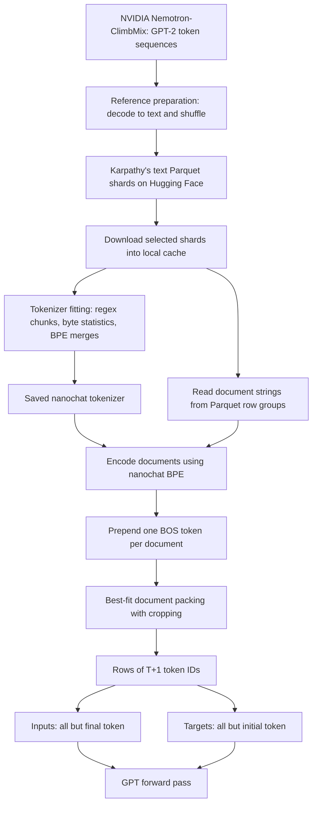

# Tokenization and pretraining data in nanochat

This note follows the complete path from a hosted text corpus to the integer input/target tensors supplied to GPT. It explains the actual data sources, byte-level BPE, tokenizer fitting and encoding, vocabulary tradeoffs, document packing, and distributed reading.

Code references are pinned conceptually to the local nanochat checkout at `92d63d4e8bb4df75c3b71618f31ddde2378b2bcd`. Hugging Face pages and upstream documentation were checked on **25 October 2026**. Their live metadata may change independently of this checkout. Python links include exact line fragments for VS Code, following the [architecture note](nanochat-model-architecture.md).

The model architecture begins with token IDs. This note explains where those IDs come from. Tokenizer fitting is a discrete statistics-based procedure, separate from gradient-based GPT training. Optimizers, training schedules, and post-training objectives are left for later notes.

## Contents

1. [The complete data path](#1-the-complete-data-path)
2. [What the pretraining corpus actually is](#2-what-the-pretraining-corpus-actually-is)
3. [Where it is hosted and stored locally](#3-where-it-is-hosted-and-stored-locally)
4. [Characters, bytes, tokens, and embeddings](#4-characters-bytes-tokens-and-embeddings)
5. [Regex pretokenization](#5-regex-pretokenization)
6. [How BPE learns a vocabulary](#6-how-bpe-learns-a-vocabulary)
7. [How a trained tokenizer encodes new text](#7-how-a-trained-tokenizer-encodes-new-text)
8. [Nanochat's vocabulary and special tokens](#8-nanochats-vocabulary-and-special-tokens)
9. [Tokenizer fitting data and saved artifacts](#9-tokenizer-fitting-data-and-saved-artifacts)
10. [Compression, vocabulary size, and bits per byte](#10-compression-vocabulary-size-and-bits-per-byte)
11. [Reading shards and dividing data between ranks](#11-reading-shards-and-dividing-data-between-ranks)
12. [Packing documents into input and target tensors](#12-packing-documents-into-input-and-target-tensors)
13. [Document boundaries, cropping, and sampling bias](#13-document-boundaries-cropping-and-sampling-bias)
14. [Connecting the files and your implementation](#14-connecting-the-files-and-your-implementation)
15. [Checks, limits, and details easy to misread](#15-checks-limits-and-details-easy-to-misread)

## 1. The complete data path



Preparation of the published corpus and reading it during a training run are different operations. A normal nanochat run downloads Karpathy's prepared shards; it does not rerun NVIDIA's curation or Karpathy's preparation script.

There are also **two different tokenizers in the provenance chain**: GPT-2's tokenizer used by the upstream release, and the new tokenizer trained for nanochat. The upstream IDs are decoded back to text before nanochat tokenizes it again.

## 2. What the pretraining corpus actually is

**Code:** [dataset location constants](../nanochat/nanochat/dataset.py#L23), [ClimbMix preparation branch](../nanochat/dev/repackage_data_reference.py#L51), and the [dataset upgrade log](../nanochat/dev/LOG.md#L107).

### 2.1 The active dataset

The default pretraining corpus for this checkout is **ClimbMix**, originally released by NVIDIA as [nvidia/Nemotron-ClimbMix](https://huggingface.co/datasets/nvidia/Nemotron-ClimbMix). Its card describes an English pretraining dataset of approximately **400 billion tokens**, released as GPT-2-tokenized sequences. It describes filtering and weighting topic groups, including advertisement detection and educational-quality assessment. This is an upstream corpus description, not the amount of data every nanochat run consumes.

Nanochat downloads [karpathy/climbmix-400b-shuffle](https://huggingface.co/datasets/karpathy/climbmix-400b-shuffle): a shuffled text representation of that corpus. The runtime reader expects a string column named `text`.

These are document strings rather than a runtime requirement for question/answer pairs, role-labelled conversations, images, or a separate answer-label column. Pretraining targets are derived directly from the text by shifting the resulting token sequence.

### 2.2 What kinds of writing are in it?

The [Nemotron-CLIMB paper, section 6](https://arxiv.org/html/2504.13161v2#S6) describes constructing the final release from **Nemotron-CC and smollm-corpus**, semantically grouping and filtering the combined material into ClimbLab, then selecting a 400B-token mixture. Nemotron-CC contributes refined Common Crawl material. Thus this is a heterogeneous corpus, including web-derived prose and curated educational/code material, rather than a single book or uniformly sampled slice of the web.

The [SmolLM corpus card](https://huggingface.co/datasets/HuggingFaceTB/smollm-corpus) identifies three components: deduplicated educational web pages, Python code selected for educational quality, and Cosmopedia v2 synthetic educational material. These explain how both code and generated instructional-style writing can appear in the upstream source pool. The components' original proportions are not automatically the proportions retained by ClimbMix.

Nanochat's [own upgrade notes](../nanochat/dev/LOG.md#L111) characterize the resulting corpus as a blend of high-quality web text, code, math, and other sources. A physics explanation, historical article, Python file, or mathematical discussion is a useful mental example of a text document. The following is **an invented schema illustration**, not a downloaded dataset record:

```json
{"text": "For a particle in a central potential, angular momentum is conserved..."}
```

An individual stored string can contain formatting, equations, code, or dialogue-looking text. What matters to the reader is that it is a string, not how it would be visually classified by a person.

The exact topic percentages of the final shuffled release are not specified in the runtime code. Its single text column also does not preserve an original URL or source label for each document. Those details cannot be recovered from the loader alone.

### 2.3 Why curate a mixture instead of taking arbitrary web text?

Let $P_k$ denote a distribution of documents in domain $k$. A mixture has the conceptual form

$$
P_{data}=\sum_{k=1}^{K}w_kP_k,\qquad
w_k\ge0,\qquad \sum_k w_k=1.
$$

Filtering changes which documents belong to each $P_k$; mixture weights change their relative exposure. Both affect the distribution the language model learns. More documents alone do not ensure a better distribution for the target capabilities.

The CLIMB framework uses semantic grouping and proxy-model experiments to search mixture weights. This curation happens upstream; nanochat consumes the already assembled corpus. The [paper](https://arxiv.org/abs/2504.13161) supplies the experimental method. This equation is a conceptual mixture model, not a claim that nanochat resamples labelled domains in its runtime loader.

### 2.4 The older FineWeb-Edu corpus

Older nanochat guides refer to **FineWeb-Edu-100B**. This checkout switched to ClimbMix on 4 March 2026, according to its [upgrade log](../nanochat/dev/LOG.md#L107).

The old preparation branch used [HuggingFaceFW/fineweb-edu](https://huggingface.co/datasets/HuggingFaceFW/fineweb-edu), configuration `sample-100BT`, and published [karpathy/fineweb-edu-100b-shuffle](https://huggingface.co/datasets/karpathy/fineweb-edu-100b-shuffle). FineWeb-Edu consists of web pages selected for educational quality. It is the legacy default, not an additional separately sampled component in the current runtime configuration. Educational web material can still enter ClimbMix through its own upstream sources.

## 3. Where it is hosted and stored locally

### 3.1 Three levels of provenance

| Level | Location | Representation |
| --- | --- | --- |
| Original published ClimbMix | [nvidia/Nemotron-ClimbMix](https://huggingface.co/datasets/nvidia/Nemotron-ClimbMix) | Rows expose `tokens`, `token_count`, and `cluster_id`; token sequences use GPT-2 IDs |
| Nanochat's prepared release | [karpathy/climbmix-400b-shuffle](https://huggingface.co/datasets/karpathy/climbmix-400b-shuffle) | Shuffled Parquet files containing document text |
| A machine running nanochat | `NANOCHAT_BASE_DIR/base_data_climbmix/` | Downloaded subset of the prepared Parquet files |

The [upstream card](https://huggingface.co/datasets/nvidia/Nemotron-ClimbMix) labels its release CC BY-NC 4.0, while the [repackaged page](https://huggingface.co/datasets/karpathy/climbmix-400b-shuffle) displays an MIT metadata tag. These are different reported labels in the provenance chain; this note does not equate them.

### 3.2 What Karpathy's preparation script does

**Code:** [reference script](../nanochat/dev/repackage_data_reference.py#L51), [shuffle](../nanochat/dev/repackage_data_reference.py#L69), and [decode/write loop](../nanochat/dev/repackage_data_reference.py#L86).

The documented preparation is:

1. Load the upstream dataset's training split.
2. Shuffle documents with seed 42.
3. Read each row's `tokens` field and decode it with GPT-2's tokenizer.
4. Accumulate the resulting strings.
5. Write a Parquet shard with the single `text` column.
6. Upload the prepared folder to the Hugging Face dataset repository.

This transforms storage and ordering. It is not another implementation of CLIMB's quality filtering or mixture search. Upstream cluster IDs and token counts are discarded by this writer.

The script targets roughly **250 million Python characters per shard**, with **1024 documents per Parquet row group**. A shard is written when the character threshold has been reached and the accumulated document count is a multiple of 1024. It uses Zstandard compression at level 3. Therefore 250M characters is a target, not an exact file length, and compressed bytes are a different quantity.

The [hosted repository](https://huggingface.co/datasets/karpathy/climbmix-400b-shuffle) reports roughly 600 GB in total at the time checked. The code comments estimate about 100 MB compressed per shard. Both are scale estimates; individual files differ.

This is a reference preparation script, not a general-purpose ingestion pipeline. For example, it does not show a final flush of a partially accumulated tail after its main loop. Treat it as documented provenance rather than assuming it proves byte-for-byte completeness of the published release.

### 3.3 File names and validation shard

**Code:** [dataset constants](../nanochat/nanochat/dataset.py#L23) and [download index selection](../nanochat/nanochat/dataset.py#L147).

Files are named

```text
shard_00000.parquet
shard_00001.parquet
...
shard_06542.parquet
```

`MAX_SHARD = 6542` is the **last index**. The configured release consequently has 6543 indexed shards: up to 6542 training shards and one reserved validation shard.

A file is fetched from a URL such as [the first shard](https://huggingface.co/datasets/karpathy/climbmix-400b-shuffle/resolve/main/shard_00000.parquet). That is a large data download endpoint, not a documentation page.

The following commands illustrate the script's behavior; **they were not executed while preparing this note**. Run such commands from the `nanochat/` directory in a suitable environment:

```bash
python -m nanochat.dataset -n 8
```

This requests training shards 0 through 7 **and** shard 6542 for validation: nine files in total. Likewise, `-n 170` selects training indices 0 through 169 plus the validation shard. Existing files are skipped.

An important code/help discrepancy: the CLI help describes `-1` as disabled, but the executed branch interprets `-1` as **all training shards**. Omitting `-n` therefore selects the full corpus plus validation.

The download function uses four workers by default, streams each file into a `.tmp` path, then renames it on success. Retries use backoff. This is shard download followed by local reading, rather than fetching documents one by one from the internet during each model step.

### 3.4 Local cache and current workspace state

**Code:** [get_base_dir](../nanochat/nanochat/common.py#L71), [DATA_DIR](../nanochat/nanochat/dataset.py#L27), and [tokenizer loading](../nanochat/nanochat/tokenizer.py#L264).

The default root is `~/.cache/nanochat`, overridden by `NANOCHAT_BASE_DIR`. Expected paths are:

```text
~/.cache/nanochat/
├── base_data_climbmix/
│   ├── shard_00000.parquet
│   └── ...
├── tokenizer/
│   ├── tokenizer.pkl
│   └── token_bytes.pt
└── base_data/                 # legacy FineWeb-Edu directory, if present
```

On this machine, the default/configured root resolves to `/Users/rifath95/.cache/nanochat`. At the time of inspection, neither data directory nor the two tokenizer artifacts existed there. The source repositories therefore describe the pipeline, but this workspace has not supplied those default cached artifacts. Files stored under another manually chosen location were not audited.

If `base_data_climbmix` is absent, [list_parquet_files](../nanochat/nanochat/dataset.py#L32) attempts the old `base_data` directory. The fallback is triggered by directory absence, not merely by an empty directory. Thus existing cache contents matter to what a run actually reads.

## 4. Characters, bytes, tokens, and embeddings

### 4.1 Four different objects

| Object | Example | Role |
| --- | --- | --- |
| Unicode text | `café` | Human-facing string |
| UTF-8 bytes | `63 61 66 c3 a9` in hexadecimal | Reversible byte representation of that string |
| Token IDs | A tokenizer-dependent integer list | Indices passed to the language model |
| Embeddings | Learned vectors indexed by those IDs | Continuous representations used by GPT |

`café` has four Unicode code points and five UTF-8 bytes. A BPE token may represent one byte, several bytes, part of a word, a word with a leading space, punctuation, or whitespace. A token is not intrinsically a word or a character.

The encoding map is

$$
\tau:\text{text}\longrightarrow\{0,\ldots,V-1\}^{*},
$$

where $*$ means a variable-length finite sequence. It is fixed during GPT training. The model then learns a table

$$
E\in\mathbb R^{V_p\times d},\qquad e_t=E[\tau(text)_t].
$$

The token ID specifies which byte sequence a token denotes; the embedding specifies how the model represents that token. IDs have no meaningful numerical distance: token 100 need not be semantically closer to 101 than to 20000.

### 4.2 Why start from bytes?

All 256 byte values are available as base tokens. Every valid UTF-8 string can therefore be represented even if its words, script, or spelling were absent from the fitting corpus. Rare material can fall back to shorter tokens, ultimately individual bytes, rather than requiring an unknown-token substitute.

Coverage and efficiency are different. A tokenizer can represent a language perfectly reversibly while splitting it into many more tokens than another language. Training distribution and pretokenization determine which byte combinations receive longer reusable tokens.

Your [character tokenizer](../transformer-from-scratch/data.py#L9) instead builds its alphabet from the observed file. An unseen character is missing from its `stoi` dictionary. It also uses one token per Python character, whereas byte BPE has both universal byte coverage and variable-length tokens.

### 4.3 Decoding and partial UTF-8

Each ordinary token ID maps to a byte string. Decoding concatenates those byte strings and interprets the resulting UTF-8 stream. For valid text encoded by the tokenizer, the desired invariant is

$$
\operatorname{decode}(\operatorname{encode}(text))=text.
$$

A single token's bytes need not be valid UTF-8 by themselves. For example, the two bytes of `é` can be separate tokens. Inspecting each token by decoding it to a standalone string can insert replacement characters and misrepresent byte lengths. Nanochat explicitly uses [decode_single_token_bytes](../nanochat/nanochat/tokenizer.py#L129) when constructing its evaluation byte counts.

Tokenization preserves the represented text; it is not inherently lowercasing, stemming, or Unicode normalization. An arbitrary sequence generated by a model can still concatenate to invalid UTF-8, so coverage of valid input strings does not mean every possible ID sequence is a valid Unicode string.

## 5. Regex pretokenization

**Code:** [SPLIT_PATTERN](../nanochat/nanochat/tokenizer.py#L26), passed into [train_from_iterator](../nanochat/nanochat/tokenizer.py#L42).

Before BPE merges bytes, nanochat splits text into chunks using this pattern:

```regex
'(?i:[sdmt]|ll|ve|re)|[^\r\n\p{L}\p{N}]?+\p{L}+|\p{N}{1,2}| ?[^\s\p{L}\p{N}]++[\r\n]*|\s*[\r\n]|\s+(?!\S)|\s+
```

The alternatives recognize contractions, letter runs with an optional leading nonletter/nonnumeric character, numeric groups of length one or two, punctuation runs, and whitespace/newlines. `\p{L}` and `\p{N}` refer to Unicode letter and number categories. Possessive quantifiers such as `++` affect regex matching; they are not BPE operations.

These chunks are **boundaries for merging**. BPE learns and applies merges inside each chunk; it does not freely merge across every adjacent byte in the whole document. Whitespace is represented, not simply thrown away.

For an ASCII illustration, the pattern splits

```text
Hello world! 12345
```

into chunks of the form

```text
["Hello", " world", "!", " ", "12", "34", "5"]
```

Each chunk subsequently becomes one or more BPE tokens. The leading space in `" world"` can participate in a learned token because it belongs to that chunk.

### 5.1 Why constrain the chunks?

Chunking limits which combinations compete for vocabulary capacity. It helps prevent merges from arbitrarily joining many linguistic units and makes the segmentation rules consistent between fitting and encoding.

The numeric choice `{1,2}` is deliberate. Nanochat's comments and [tokenizer experiment log](../nanochat/dev/LOG.md#L809) report that one/two-character number chunks worked better at its 32K vocabulary scale than the compared one- or three-digit alternatives. For decimal digits alone, there are 100 possible two-digit strings versus 1000 three-digit strings; allocating tokens to all longer combinations can consume substantial capacity. This is an empirical tradeoff, not a requirement of BPE.

The regex constrains a number's chunking, not a guarantee that every two-digit chunk is one final token. BPE may still split it further. Nor does preserving byte coverage imply that these language-oriented regex boundaries are equally efficient for every language or task.

## 6. How BPE learns a vocabulary

**Code boundary:** nanochat calls [RustBPETokenizer.train_from_iterator](../nanochat/nanochat/tokenizer.py#L42); the merge-learning implementation lives in [rustbpe](https://github.com/karpathy/rustbpe), not inside nanochat's Python model. The local lockfile selects rustbpe 0.1.0.

### 6.1 Initial alphabet and pair counts

Start with 256 tokens, one for each byte. After regex splitting, represent chunk $i$ as a sequence of current token IDs

$$
s^{(i)}=(s^{(i)}_0,\ldots,s^{(i)}_{n_i-1}).
$$

If a chunk occurs $f_i$ times in the corpus, define the adjacent pair count

$$
C(a,b)=\sum_i f_i\sum_{j=0}^{n_i-2}
\mathbf1[s^{(i)}_j=a,\ s^{(i)}_{j+1}=b].
$$

Identical chunks can be counted once with a frequency weight. This is an efficiency representation of the same corpus statistics, not a change to which texts were supplied.

Choose a highest-frequency available pair $(a^*,b^*)$, allocate a new ID $m$, and assign it the concatenated bytes

$$
\operatorname{bytes}(m)=
\operatorname{bytes}(a^*)\Vert\operatorname{bytes}(b^*).
$$

Replace its non-overlapping occurrences, update the counts of affected neighboring pairs, and repeat. Old tokens remain in the vocabulary. Ties follow the implementation's tie-breaking rule; different choices can produce different later merges.

The [Rust implementation](https://github.com/karpathy/rustbpe/blob/master/src/lib.rs) maintains weighted chunk counts and updates pair statistics incrementally using a priority queue. Merging is left-to-right for overlapping occurrences: `aaa` merged on `aa` becomes `[aa, a]`, not overlapping tokens `[aa, aa]`. Pair frequencies can count overlapping adjacent positions, so the frequency used to select a pair is not always the exact number of replacements it performs.

### 6.2 A complete small example

Consider a toy corpus consisting of `banana` three times and `band` twice. Each is one letter-run chunk. Initially, ASCII letters are byte tokens. Adjacent counts are:

| Pair | Weighted count |
| --- | ---: |
| `a n` | 8 |
| `n a` | 6 |
| `b a` | 5 |
| `n d` | 2 |

Merge `a n` into token 256, representing `an`:

```text
banana -> [b, an, an, a]
band   -> [b, an, d]
```

Now `b an` occurs five times and is the most frequent pair. Merge it into token 257, representing `ban`:

```text
banana -> [ban, an, a] -> [257, 256, 97]
band   -> [ban, d]     -> [257, 100]
```

The original corpus contains $3\cdot6+2\cdot4=26$ bytes. After these two merges it contains $3\cdot3+2\cdot2=13$ token positions. The same text is represented using half as many positions, at the cost of two additional vocabulary entries. These IDs are illustrative; the real 32K tokenizer learns a different vocabulary.

### 6.3 What fitting optimizes

Frequent adjacent pairs are a greedy route to shorter sequences. BPE does not backpropagate a language-model loss, learn semantic embeddings, or solve a globally optimal segmentation problem for eventual GPT performance. Its vocabulary reflects corpus frequencies under the chosen regex and fitting subset.

For target vocabulary size $V$ and $S_{special}$ reserved IDs, the requested ordinary vocabulary is $V-S_{special}$. Starting from 256 bytes gives a nominal merge budget

$$
N_{merges}=V-S_{special}-256.
$$

If a tiny corpus runs out of mergeable pairs, a trainer may finish below the requested size. Special IDs must therefore be assigned after the actual ordinary vocabulary, as nanochat's wrapper does.

## 7. How a trained tokenizer encodes new text

**Code:** [RustBPETokenizer.encode](../nanochat/nanochat/tokenizer.py#L96), which delegates ordinary encoding to tiktoken. The lockfile selects tiktoken 0.11.0. Its [educational implementation](https://github.com/openai/tiktoken/blob/0.11.0/tiktoken/_educational.py) is useful for following the algorithm.

Encoding a new string does not recompute corpus pair frequencies or change the vocabulary:

1. Apply the same regex to obtain chunks.
2. Convert a chunk to UTF-8 bytes.
3. Begin with one byte per piece.
4. Among adjacent pieces whose concatenation is a learned token, merge according to the lowest available learned merge rank.
5. Repeat until no eligible adjacent merge remains, then concatenate the chunks' ID lists.

The learned rank records merge priority, not how frequent a pair happens to be in this new string. In the toy example, the fixed `a n` rule precedes `b an`. This is a deterministic vocabulary-driven encoding procedure, rather than a fresh fitting run for each prompt or a generic longest-dictionary-match rule.

In nanochat's [export construction](../nanochat/nanochat/tokenizer.py#L49), `mergeable_ranks` maps **token byte strings to integer ranks/IDs**. It is not a map from token IDs to learned embedding vectors. Tiktoken uses those ranks, the regex, and the explicit special-token mapping to construct an `Encoding` object.

Batch encoding accepts a list of document strings and uses `encode_ordinary_batch`; single-string encoding uses `encode_ordinary`. Both return integer IDs. Converting IDs back into text uses the fixed byte mapping, while GPT's learned embeddings remain a separate artifact in the model checkpoint.

## 8. Nanochat's vocabulary and special tokens

**Code:** [SPECIAL_TOKENS](../nanochat/nanochat/tokenizer.py#L9), [ordinary vocabulary budget](../nanochat/nanochat/tokenizer.py#L46), and [special ID assignment](../nanochat/nanochat/tokenizer.py#L53).

The default total vocabulary is $V=32768$. Nine entries are reserved for structural markers, leaving 32759 ordinary byte-string tokens. If fitting reaches its target, the nominal merge count is

$$
32768-9-256=32503.
$$

The special IDs are allocated consecutively after the actual ordinary vocabulary. With the full default vocabulary, they are:

| Marker | ID | Purpose |
| --- | ---: | --- |
| `<\|bos\|>` | 32759 | Beginning of a document/sequence |
| `<\|user_start\|>` | 32760 | Begin user message |
| `<\|user_end\|>` | 32761 | End user message |
| `<\|assistant_start\|>` | 32762 | Begin assistant message |
| `<\|assistant_end\|>` | 32763 | End assistant message |
| `<\|python_start\|>` | 32764 | Begin assistant tool invocation |
| `<\|python_end\|>` | 32765 | End invocation |
| `<\|output_start\|>` | 32766 | Begin externally supplied tool result |
| `<\|output_end\|>` | 32767 | End tool result |

The backslashes escape table separators in Markdown; the actual marker strings contain ordinary vertical bars, as shown in the source.

These nine tokens are inserted explicitly; BPE does not discover them by counting their spellings in the corpus. The default pretraining loader prepends BOS to documents. Message/tool markers are available for later conversation rendering and are not automatically added around pretraining prose.

### 8.1 A marker string and a marker ID are different

`tokenizer.encode("<|bos|>")` uses ordinary encoding and treats that spelling as text. It does not automatically insert the reserved BOS ID. By contrast,

```python
tokenizer.encode_special("<|bos|>")
tokenizer.encode(document, prepend="<|bos|>")
```

explicitly request the structural ID. This prevents a document that happens to contain the marker's literal spelling from being interpreted as a structural boundary merely because of those characters. The distinction is checked by [test_special_tokens](../nanochat/tests/test_tokenizer.py#L37) and implemented through [encode_ordinary](../nanochat/nanochat/tokenizer.py#L104).

### 8.2 Keep the tokenizer and model together

An embedding row and output-classifier row refer to the meaning assigned to their integer ID. Replacing the tokenizer with a different vocabulary or merge mapping while retaining a checkpoint changes those meanings. Equal vocabulary sizes alone do not make two tokenizers interchangeable.

Within the normal pipeline, the saved tokenizer is reused for base training, chat training, evaluation, and inference. `from_pretrained("gpt2")` is also available, but a normal tokenizer-fitting run creates a new nanochat encoding; it is not silently using GPT-2's or GPT-4's pretrained merge vocabulary.

## 9. Tokenizer fitting data and saved artifacts

**Code:** [tok_train.py arguments](../nanochat/scripts/tok_train.py#L16), [text_iterator](../nanochat/scripts/tok_train.py#L28), [training/export](../nanochat/scripts/tok_train.py#L49), and [byte-count artifact](../nanochat/scripts/tok_train.py#L76).

### 9.1 Which text fits the tokenizer?

The defaults are:

| Setting | Default | Interpretation |
| --- | ---: | --- |
| `max_chars` | 2,000,000,000 | Approximate upper threshold for Python-character exposure |
| `doc_cap` | 10,000 | Keep at most this many characters from each fitting document |
| `vocab_size` | 32,768 | Ordinary and special token IDs combined |

`text_iterator` reads the training split's Parquet row groups, yields each document's capped prefix, and accumulates `len(doc_text)`. This counts Python string characters, not UTF-8 bytes, GPT-2 tokens, or eventual nanochat tokens.

The counter is tested **after yielding** a document, using `nchars > max_chars`. It can overshoot the threshold by the final capped document. If the downloaded training subset runs out first, it can also finish below the threshold. The 10,000-character cap applies here to tokenizer fitting; the pretraining loader does not apply that same character cap before encoding.

Long-document prefix capping helps limit one document's contribution and fitting cost, while also biasing fitting toward document beginnings. Frequency statistics therefore depend on this sampling policy as well as on the corpus itself.

The tokenizer is fitted on training shards, excluding the locally selected validation shard. No model checkpoint is needed for this fitting step.

### 9.2 What gets saved?

Under `NANOCHAT_BASE_DIR/tokenizer/`, the script writes:

- `tokenizer.pkl`: the tiktoken `Encoding` object, including its regex, ordinary token-byte/rank mapping, and special-token mapping.
- `token_bytes.pt`: a length-$V$ int32 tensor containing each ordinary token's raw byte length; special IDs receive zero.

Neither file contains GPT's learned embedding table. That table belongs to the model checkpoint.

For a token with raw bytes `b'\xc3'`, its byte count is one even though that byte alone is not a valid standalone UTF-8 character. This is why the [artifact builder](../nanochat/scripts/tok_train.py#L79) measures raw bytes rather than decoding each token and measuring the resulting string.

The [tokenizer test fixture](../nanochat/tests/test_tokenizer.py#L22) uses a tiny in-memory corpus for checks of round trips, special tokens, and conversation rendering. Its miniature vocabulary is a test fixture, not the default pretrained tokenizer.

## 10. Compression, vocabulary size, and bits per byte

### 10.1 Bytes per token

For a text whose UTF-8 representation has $M$ bytes and whose encoding contains $N$ ordinary tokens, define

$$
R=\frac MN\quad\text{bytes per token}.
$$

A larger $R$ means fewer model positions for the same byte sequence. It is a tokenization compression measure, not the same as the Zstandard compression ratio of a Parquet file.

For a context window of $T$ tokens, the approximate text coverage at ratio $R$ is $TR$ bytes. For a fixed $M$ bytes, the sequence length is roughly $M/R$. Full-attention pairwise arithmetic then scales approximately as

$$
O\!\left((M/R)^2d\right),
$$

while dense tokenwise matrix products scale roughly linearly in $M/R$. Local attention changes the pairwise scaling as explained in the architecture note. These are scaling estimates; a single ratio does not capture every document's segmentation.

Nanochat's [tok_eval.py](../nanochat/scripts/tok_eval.py#L179) measures bytes/token and round trips on several text categories and training/validation samples, comparing its fitted encoding with GPT-2 and `cl100k_base`. The name `cl100k_base` identifies a particular encoding; it should not be treated as the tokenizer for every present or future GPT-4-family model.

### 10.2 Why not make the vocabulary enormous?

A larger vocabulary can represent more frequent byte patterns with single IDs, but enlarges parameter tables and the output classifier. Using the architecture note's notation, vocabulary-dependent parameters are

$$
P_{vocab}=V_p(2d+M_{VE}d_{kv}),
$$

where $M_{VE}=\lceil L/2\rceil$ is the number of value-embedding layers. The two main tables are the ordinary embedding and independent unembedding; each selected layer adds its own value table.

For the reference model, $d=d_{kv}=768$ and $M_{VE}=6$, so adding 1024 allocated vocabulary rows adds

$$
1024\cdot(2\cdot768+6\cdot768)
=6,291,456
$$

parameters. The output projection also creates more logits and performs more work per position. Rare long tokens receive less direct exposure, while shorter reusable tokens can share statistical strength across contexts. Vocabulary selection is a joint capacity, compute, segmentation, and generalization tradeoff.

Token IDs are stored in this loader as `torch.long` (64-bit integers), even though a 32768-item vocabulary could theoretically be indexed in 15 bits. Bytes/token measures text represented per model position, not the actual memory width of the input tensor's integer dtype.

### 10.3 Why raw loss per token is hard to compare across tokenizers

A token can cover one byte or many. Changing segmentation changes the unit being predicted, so mean negative log probability per token is not directly comparable across vocabularies.

Nanochat uses [evaluate_bpb](../nanochat/nanochat/loss_eval.py#L9), which accumulates negative log probabilities and byte lengths over ordinary, unmasked target tokens. Let $\mathcal I$ be those positions and $b(y_i)$ the raw byte length of target token $y_i$. Then

$$
\operatorname{BPB}=
\frac{\sum_{i\in\mathcal I}-\ln p_\theta(y_i\mid x_{\le i})}
{\ln2\;\sum_{i\in\mathcal I}b(y_i)}.
$$

The numerator is in nats; dividing by $\ln2$ converts it to bits. BOS and other special targets have byte count zero and are excluded from this metric. Targets masked with the ignore index are also excluded.

If ordinary-token mean loss is $\bar\ell$ and their average bytes/token is $R$, this becomes

$$
\operatorname{BPB}=\frac{\bar\ell}{R\ln2}.
$$

This normalizes the reporting unit. It does not make all evaluations identical: different tokenizers and packing policies can expose different text spans and context, and special-token likelihoods still participate in the model's vocabulary softmax. Comparing the same held-out text under controlled context and preprocessing remains important.

## 11. Reading shards and dividing data between ranks

**Code:** [list_parquet_files](../nanochat/nanochat/dataset.py#L32), [parquets_iter_batched](../nanochat/nanochat/dataset.py#L67), and [_document_batches](../nanochat/nanochat/dataloader.py#L25).

### 11.1 Parquet files, row groups, and documents

A **shard** is a file. A **row group** is a block of rows within that file. A **row** here contains one document string. Loading one row group is different from loading the entire corpus, or even the entire shard, into memory.

The reader calls `ParquetFile.read_row_group`, selects the `text` column, and converts that group to a Python list of strings. The reference writer specifies 1024-document row groups. `_document_batches` subdivides groups into tokenizer batches of 128 documents by default.

These batch notions serve different purposes:

| Quantity | Meaning |
| --- | --- |
| Parquet row group | Storage/read unit, documented as 1024 documents |
| `tokenizer_batch_size` | Number of documents passed together toward encoding, default 128 |
| `buffer_size` | Target minimum number of tokenized documents available for packing, default 1000 |
| Model batch $B$ | Number of fixed-length token rows per rank |
| Context length $T$ | Input token positions per model row |

Reading more documents at once does not imply a larger GPT batch. Packing converts variable document lengths into fixed token rows later.

### 11.2 How train and validation are selected

The reader sorts locally present `.parquet` paths, uses all but the last as training, and the last as validation. With a successful standard download, the downloader's always-included `shard_06542.parquet` makes this a stable held-out shard.

This is a file-level holdout, unlike your 90/10 split of one character stream. The actual selection still depends on which files are present: manually assembling a directory without the reserved shard makes the highest available file become validation instead.

The loader itself does not perform deduplication or benchmark decontamination. Holding out a file is also distinct from guaranteeing that no near-duplicate document appears in training.

### 11.3 Distributed document ownership

For world size $W$ and rank $r\in\{0,\ldots,W-1\}$, the normal reader assigns row-group indices

$$
r,\ r+W,\ r+2W,\ldots
$$

within each shard. With two ranks, rank 0 reads row groups 0,2,4,... and rank 1 reads 1,3,5,... . They read disjoint groups in the normal pass, then each rank tokenizes and packs its own documents.

The document source is infinite: after exhausting its files it increments `epoch` and starts again. The runtime code does not reshuffle the corpus at every epoch. The published seed-42 preparation shuffle and the local best-fit reordering are separate operations.

### 11.4 Resume is approximate

The yielded state records `pq_idx`, `rg_idx`, and `epoch`. On resume, the reader advances beyond the recorded row-group round and restores rank-based ownership.

It does not save the exact position inside a tokenizer sub-batch or the outstanding document-packing buffer. Prefetching can advance the recorded source location beyond the documents already used by GPT. Consequently this state supports approximate progress recovery, rather than exact reproduction of the next packed batch after interruption.

## 12. Packing documents into input and target tensors

**Code:** [tokenizing_distributed_data_loader_with_state_bos_bestfit](../nanochat/nanochat/dataloader.py#L74), [buffer refill and BOS insertion](../nanochat/nanochat/dataloader.py#L104), [best-fit/cropping loop](../nanochat/nanochat/dataloader.py#L122), and [target shifting](../nanochat/nanochat/dataloader.py#L153).

### 12.1 Encode each document and prepend BOS

For document $d_j$, construct

$$
z^{(j)}=[\operatorname{BOS}]\Vert\tau(d_j).
$$

This is a variable-length list of IDs. The loader does not append a separate EOS token. Another document's BOS can mark a new document when lists are concatenated.

A buffer holds encoded documents. Its default threshold is 1000; refilling adds batches, so its length can exceed that threshold. Tokenization happens at runtime from stored text rather than reading a permanent cache of nanochat token IDs from these Parquet files.

### 12.2 Fill one row of capacity $T+1$

Set row capacity to $T+1$. Repeatedly:

1. Refill the document buffer when it is below the threshold.
2. Find the **longest complete document** whose encoded length fits the remaining slots.
3. Remove that document from the buffer and append it to the row.
4. If none fits, remove the **shortest buffered document**, take only enough of its prefix to fill the row, and discard its unused suffix.

Repeat for each of the $B$ rows. This is a bin-packing heuristic with cropping, rather than a sequential token stream split at every $T$ positions. It can reorder the incoming documents, and cropped suffixes are not carried into the next row.

Every row begins with BOS because every appended document/prefix begins with BOS. There are no padding positions in the resulting pretraining batch.

### 12.3 A worked packing example

Use $T=6$, so a stored row needs seven IDs. Suppose the available encoded documents are

```text
A = [BOS, 11, 12]          length 3
B = [BOS, 21, 22, 23]      length 4
C = [BOS, 31, 32, 33, 34]  length 5
```

These are invented token IDs for illustrating the packer, not an actual vocabulary example. Suppose refills add documents of the same lengths.

The longest complete fit is C, leaving two slots. No complete document has length at most two, so the shortest available document A is cropped to `[BOS, 11]`. Its token 12 is discarded. The row is

```text
row = [BOS, 31, 32, 33, 34, BOS, 11]
```

Now shift once:

```text
inputs  = [BOS, 31, 32, 33, 34, BOS]
targets = [ 31, 32, 33, 34, BOS,  11]
```

In particular, the model learns to predict the later BOS from the preceding context and token 11 after that BOS. No target for the row's very first BOS is created because it has no preceding input position within this row.

### 12.4 Why $T+1$ tokens?

For a packed row $r_0,\ldots,r_T$,

$$
X_{b,t}=r_t,\qquad Y_{b,t}=r_{t+1},
\qquad t=0,\ldots,T-1.
$$

Thus $X,Y\in\{0,\ldots,V-1\}^{B\times T}$. GPT's output at position $t$ is evaluated against the next token $Y_{b,t}$, while causal attention limits its input context to $X_{b,\le t}$.

Both arrays include the same token sequence shifted by one position. This is exactly the target-shifting principle used by your [get_batch](../transformer-from-scratch/data.py#L26), with different tokenization, corpus reading, and row assembly.

### 12.5 Buffers and device transfer

The implementation preallocates a $B\times(T+1)$ row buffer, a CPU staging buffer containing both $B\times T$ arrays, and an equivalent device buffer. Input and target views are contiguous, and a single copy transfers both arrays to the device. The conditional `device == "cuda"` controls pinned-memory/nonblocking options in this function.

The yielded input/target tensors reuse this device allocation. A scratch analysis that keeps batches across subsequent generator calls should clone them; retaining a view does not preserve an immutable historical batch.

## 13. Document boundaries, cropping, and sampling bias

### 13.1 BOS is a signal, not an attention barrier

The input arrays contain BOS tokens but no document-ID attention mask. Ordinary causal/local attention therefore allows tokens in a later document to attend to earlier documents within the same row, subject to the layer's window.

BOS gives the model a learned signal that new material starts. It does not reset RoPE positions within the row, reset smear, or mathematically prohibit cross-document interaction. Position indices restart with each fresh model row, rather than automatically at each internal BOS.

The [cross-document masking experiment](../nanochat/dev/LOG.md#L717) discusses testing a stronger attention barrier. The runtime loader here does not implement that alternative.

### 13.2 No padding and no data loss are different properties

All $BT$ prediction slots in a pretraining batch contain targets rather than padding. But some source tokens were discarded when documents were cropped. Full use of allocated model slots therefore does not imply full retention of downloaded text.

For one packing operation, a useful retention statistic is

$$
\eta_{retained}=
\frac{\text{source tokens placed in rows}}
{\text{source tokens in documents removed from the buffer}}.
$$

In the example above, seven of the eight IDs in the two consumed documents are retained. Meanwhile the model batch has six real prediction targets and no padding. These measure different things.

The comments' roughly 35% cropping figure comes from historical experiments documented in [the January packing log](../nanochat/dev/LOG.md#L745). That predates the ClimbMix switch. It should not be read as a newly measured universal loss rate for every corpus, tokenizer, buffer size, or context length.

### 13.3 Packing changes exposure

The heuristic favors complete documents that fit available space and keeps prefixes when it must crop. Long-document endings can consequently receive less exposure than beginnings. Fixed token length also corresponds to different character/byte spans across documents and tokenizers.

The shuffled source distribution is therefore not identical to the distribution of retained target positions. Dataset curation, tokenizer fitting caps, BPE segmentation, packing selection, and cropping all influence which text eventually contributes predictions.

This is why statements such as “trained on 400B tokens” require an accounting convention. Distinguish upstream corpus size, downloaded data, runtime-encoded tokens, retained packed tokens, and the number of target positions actually processed. A short speedrun reads only a subset of the available corpus.

### 13.4 Pretraining and conversation batches differ

The current pretraining loader creates ordinary shifted targets without assistant-only masks or padding ignore indices. BOS appearing as a later target can participate in the pretraining loss, although special tokens are excluded from the BPB reporting metric.

Later, [render_conversation](../nanochat/nanochat/tokenizer.py#L140) uses the same tokenizer to add message/tool markers and create supervision masks. Conversation SFT also uses a different packing generator. Those stages reuse the vocabulary but change how examples and supervised positions are assembled; they are not already being performed by the pretraining loader.

## 14. Connecting the files and your implementation

### 14.1 Reading order through the code

| Step | Exact source entry | What to look for |
| --- | --- | --- |
| Find cache root | [common.get_base_dir](../nanochat/nanochat/common.py#L71) | Environment override and default path |
| Identify/download corpus | [dataset constants](../nanochat/nanochat/dataset.py#L23), [download_single_file](../nanochat/nanochat/dataset.py#L84) | Hosted URLs and local shard files |
| Understand provenance | [repackage_data_reference.py](../nanochat/dev/repackage_data_reference.py#L51) | GPT-2 decoding, shuffle, text-column export |
| Select fitting text | [tok_train.text_iterator](../nanochat/scripts/tok_train.py#L28) | Training split, per-document cap, character counter |
| Fit/export vocabulary | [RustBPETokenizer.train_from_iterator](../nanochat/nanochat/tokenizer.py#L42) | Rust training and tiktoken construction |
| Encode documents | [RustBPETokenizer.encode](../nanochat/nanochat/tokenizer.py#L96) | Ordinary encoding and explicit prepend/append |
| Divide storage reads | [_document_batches](../nanochat/nanochat/dataloader.py#L25) | Rank stride, row groups, approximate resume |
| Assemble GPT rows | [best-fit loader](../nanochat/nanochat/dataloader.py#L74) | BOS, buffered documents, packing, cropping, shifting |
| Evaluate byte units | [evaluate_bpb](../nanochat/nanochat/loss_eval.py#L9) | Valid target losses divided by represented bytes |

`runs/speedrun.sh` connects [selected-shard download and tokenizer fitting](../nanochat/runs/speedrun.sh#L45) to pretraining. It starts with eight training shards, downloads more in the background, and fits/evaluates the tokenizer before launching the base model. These are orchestration choices rather than requirements of the BPE algorithm.

### 14.2 Comparison with your Tiny Shakespeare pipeline

| Component | Your implementation | Nanochat |
| --- | --- | --- |
| Corpus | One local text file | Selected local shards of a hosted prepared corpus |
| Vocabulary | Unique observed characters | 256 base bytes, learned merges, and reserved markers |
| Fitting | Collect an alphabet | Regex-constrained corpus pair statistics |
| Unseen text | Unseen characters can fail dictionary lookup | Valid UTF-8 can fall back to byte tokens |
| Sequence construction | Random contiguous character windows | Document-buffer packing with prefix cropping |
| Train/validation | 90/10 split of one encoded stream | Last local shard held out |
| Distribution across ranks | Single-process batch sampler | Rank-strided Parquet row groups |
| Target construction | One-position shift | The same one-position shift after packing |
| Evaluation units | Mean cross-entropy per character token | BPB over ordinary target bytes, plus later capability evaluations |

## 15. Checks, limits, and details easy to misread

### 15.1 Small optional checks

1. Encode the word `café` as UTF-8 by hand. Explain why measuring Python characters and raw bytes gives different counts.
2. Reproduce the two `banana`/`band` merges and verify that pair counts are recomputed after the first merge.
3. Explain why numeric regex chunks `12`, `34`, `5` do not guarantee final tokens `12`, `34`, `5`.
4. With a full default vocabulary, derive the number of ordinary tokens, learned merges, and the BOS ID.
5. Reconstruct the seven-ID packed row and its six input/target positions. Identify the discarded suffix.
6. For three ranks, list ownership of row groups 0 through 8. Explain why each rank's packing order can differ.
7. Compute BPB for 200 nats of ordinary-token loss covering 400 bytes: $200/(400\ln2)\approx0.7213$ bits/byte.
8. Explain why a file-level validation holdout, a BOS boundary, and a document-level attention barrier are three different concepts.

Once shards and project dependencies are available, this optional snippet inspects the stored schema and two document prefixes without reading an entire file into memory. Run it from `nanochat/`; it was not executed for this note:

```python
import pyarrow.parquet as pq
from nanochat.dataset import list_parquet_files

path = list_parquet_files()[0]
pf = pq.ParquetFile(path)
print(path, pf.schema_arrow, pf.num_row_groups)
docs = pf.read_row_group(0, columns=["text"]).column("text").to_pylist()
for text in docs[:2]:
    print(repr(text[:500]))
```

This displays actual stored material rather than the invented schema illustration above. Two prefixes are useful for inspecting format, not for estimating the corpus's domain proportions.

### 15.2 Scope of verification

This note's dataset contents and lineage are based on publisher documentation, the CLIMB paper, and nanochat's preparation code. The prepared dataset's live viewer failed to expose rows during this inspection, and there is no default local corpus cache here. No actual ClimbMix document text was downloaded or audited. The schema illustration and packing example are explicitly synthetic.

The toy BPE pair counts, merges, IDs, compression total, and byte round trips were checked. The actual source definitions of the packer, distributed document iterator, and fitting-text iterator were executed in memory with synthetic documents and a fake Parquet interface. These checks reproduced the packed-row example, three-rank disjoint row-group ownership, resume offset, and character-cap/threshold behavior.

No corpus download, production-tokenizer fitting, or model-training job was launched. The local interpreter lacks rustbpe, tiktoken, and PyArrow, so the real-library tokenizer suite and real Parquet reads were not run. Synthetic checks validate the described arithmetic and tested source logic, not corpus-wide quality, mixture percentages, or measured throughput.

### 15.3 Reproducibility distinctions

The source checkout is pinned, but its download URLs use Hugging Face's mutable `main` revision. For an exact reproduction, the dataset revision/file identities, selected local shard set, tokenizer artifact, library versions, and packing configuration all matter. A vocabulary size or a file basename alone is insufficient to identify an exact run.

| Easy misreading | Actual distinction |
| --- | --- |
| ClimbMix's 400B are the nanochat tokens consumed in every run | It is an upstream dataset-scale label; runtime segmentation, cropping, and training duration differ |
| The loader directly trains on NVIDIA's GPT-2 IDs | Preparation decodes those IDs; runtime encodes the text with nanochat's tokenizer |
| Eight requested shards means eight files total | The downloader adds the reserved validation shard |
| `MAX_SHARD=6542` means 6542 total files | Indices 0 through 6542 give 6543 configured files |
| Two billion fitting characters means two billion bytes/tokens | The counter measures capped Python strings and can stop above or below its nominal threshold |
| BPE learns embeddings | BPE fits byte merges; GPT learns vector parameters separately |
| A structural marker's spelling always creates its special ID | Ordinary encoding treats it as text; explicit marker encoding inserts the structural ID |
| Higher bytes/token is automatically a better language model | Compression, vocabulary cost, data exposure, and model quality are distinct |
| No padding means all downloaded text is trained on | Cropped suffixes can be discarded before rows are emitted |
| BOS prevents cross-document attention | The current positional masks do not enforce document separation |
| Epoch restart reshuffles the corpus | This loader repeats the file/row-group order without a fresh shuffle |
| Resume state restores the exact next batch | It omits the buffered documents and within-group cursor |

Once this data path is clear, the next topic is the pretraining step itself: likelihood, gradient accumulation, token budgets, and checkpointed optimization state.
