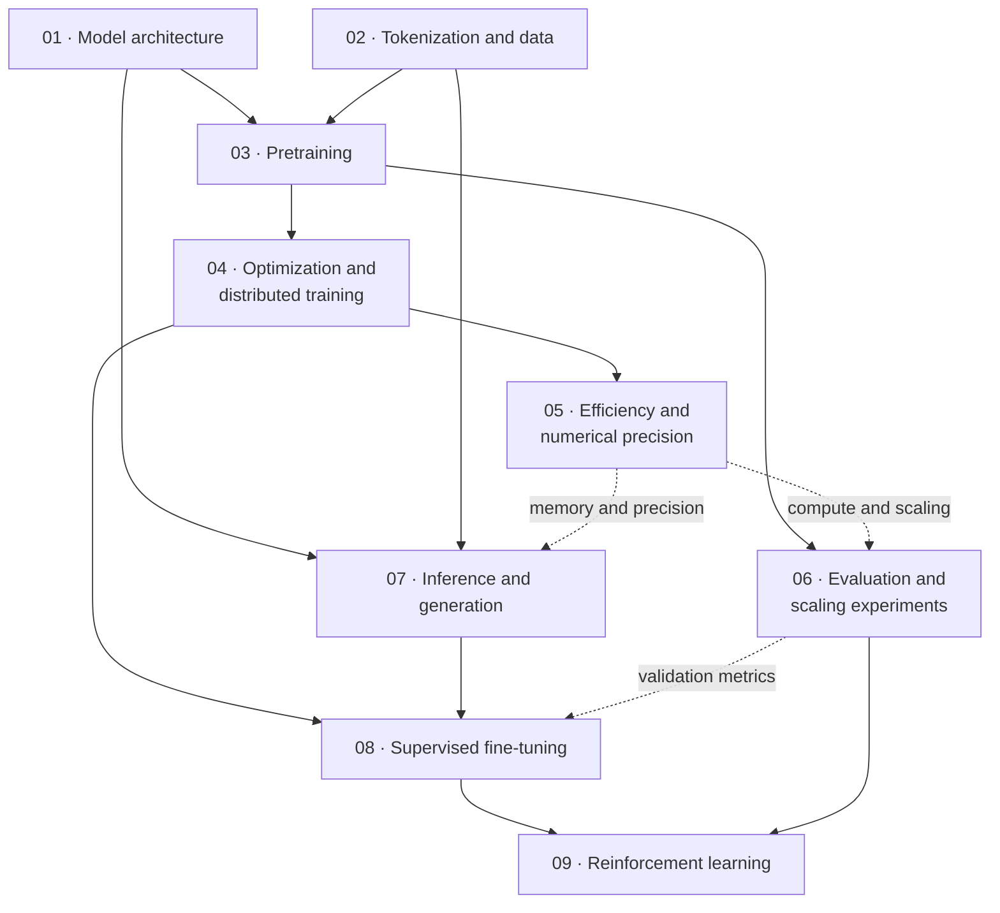

# Learning nanochat: from model to conversational LLM

**Status:** the core guide is complete: nine chapters covering nanochat's model, training, evaluation, inference, and post-training. The chapter numbers give a recommended reading order; the prerequisite diagram at the end shows which topics depend on others.

Based on the local checkouts inspected on 23 October 2026: `nanochat` at `92d63d4` and `transformer-from-scratch` at `56092a1`. The executable code is our reference when comments or older guides disagree. Neither repository was modified.

## Your starting point

Your implementation already provides a strong architectural foundation. We will focus on differences and the training system around the model, assuming familiarity with PyTorch, attention, backpropagation, and linear algebra.

| Area | Your implementation | What this nanochat checkout adds or changes |
| --- | --- | --- |
| Attention | `Multi_Headed_Latent_Attention`: compressed latent cache, partial RoPE, shared rotary keys | `CausalSelfAttention`: explicit K/V projections, full-head RoPE, QK normalization, gated value embeddings, local/full attention windows |
| Feedforward | `MLPexperts`, `Router`, `MoE`: SwiGLU experts, top-k routing, capacity limits, balancing loss | Dense ReLU² MLP; no MoE |
| Residuals and normalization | Learned RMSNorm scales, pre-norm blocks, residual projection initialization | Parameter-free RMSNorm, embedding normalization, learned residual/input mixing, embedding “smear,” mid-layer “backout,” zero-initialized output projections |
| Output | Tied token embedding/unembedding weights | Untied weights, padded vocabulary, logit softcapping |
| Data | Character vocabulary; random windows from Tiny Shakespeare | Trained byte-level BPE; sharded ClimbMix data; document packing and distributed iteration |
| Training | AdamW, warmup/cosine schedule, gradient accumulation, clipping, autocast | Mixed Muon/AdamW, scaling-based configuration, optimizer-managed distributed communication, explicit precision, optional FP8, checkpoint/resume |
| Generation and evaluation | Latent-cache sampling; cross-entropy validation | Preallocated KV cache, batched rollouts, tool execution, BPB, CORE, ChatCORE, task rewards |
| Post-training | No SFT or RL training stage in the inspected code | Conversation SFT and verifiable-reward RL on GSM8K |

Anchors for your baseline: [model.py](../transformer-from-scratch/model.py), [train.py](../transformer-from-scratch/train.py), [data.py](../transformer-from-scratch/data.py), and [your mathematical notes](../transformer-from-scratch/MATH_BEHIND_THE_CODE.md).

Two distinctions we will preserve: your active attention implementation is latent attention, rather than ordinary GQA; nanochat supports GQA, but `build_model_meta()` currently sets `n_kv_head = n_head`, giving ordinary multi-head attention in the default training path.

## Learning stages

### 1. [Architecture: reconstruct the complete forward pass](01-nanochat-model-architecture.md)

**Goal:** express the actual model as equations and track every tensor shape.

- Read [gpt.py](../nanochat/nanochat/gpt.py): `GPTConfig`, `GPT.forward`, `Block.forward`, `CausalSelfAttention.forward`, `MLP.forward`, `norm`, `apply_rotary_emb`, and `GPT.init_weights`.
- Split this stage into short lessons: residual stream and output; attention and position encoding; MLP, initialization, and added mechanisms.
- Compare against `MyGPT`, `Block`, `RMSNorm`, `Multi_Headed_Latent_Attention`, and `MLPexperts` in your code.
- Mathematical focus: normalization and attention-logit scale, RoPE conventions, gradient flow at initialization, parameter counts, and dense versus sparse compute. Separate empirical design choices from mathematical guarantees.
- Suggested check: calculate parameter counts and attention shapes for one small configuration; predict which weights receive nonzero gradients on the first backward pass.

### 2. [Tokenization and pretraining data](02-nanochat-tokenization-and-data.md)

**Goal:** follow raw document text into the exact input/target tensors.

- Read [tokenizer.py](../nanochat/nanochat/tokenizer.py): `RustBPETokenizer.train_from_iterator`, `encode`, and `decode`; [tok_train.py](../nanochat/scripts/tok_train.py): `text_iterator`; and [tok_eval.py](../nanochat/scripts/tok_eval.py).
- Trace [dataset.py](../nanochat/nanochat/dataset.py), [dataloader.py](../nanochat/nanochat/dataloader.py): `_document_batches` and `tokenizing_distributed_data_loader_with_state_bos_bestfit`; consult [repackage_data_reference.py](../nanochat/dev/repackage_data_reference.py) for provenance.
- Mathematical focus: BPE compression, vocabulary/context/compute tradeoffs, next-token target shifting, document boundaries, cropping bias, and train/validation separation. Compare with your character encoding and `get_batch`.
- Suggested check: hand-trace two packed documents, including their BOS tokens and shifted targets. Determine whether BOS actually prevents attention across documents.

### 3. [Pretraining: objective, budgets, and one optimizer step](03-nanochat-pretraining.md)

**Goal:** account for every token, loss normalization, and update in a training run.

- Read [base_train.py](../nanochat/scripts/base_train.py): `build_model_meta`, training-horizon calculation, `get_lr_multiplier`, `get_muon_momentum`, `get_weight_decay`, and the main loop; compare with your [train.py](../transformer-from-scratch/train.py).
- Mathematical focus: conditional likelihood, gradient accumulation, global token batch size, FLOPs estimates, data-to-parameter ratios, and learning-rate/weight-decay scaling. Distinguish tuned scaling rules from universal laws.
- Follow [checkpoint_manager.py](../nanochat/nanochat/checkpoint_manager.py): `save_checkpoint` and `load_checkpoint`, including optimizer shards, metadata, and approximate data-loader resume.
- Suggested check: calculate accumulation steps and total training tokens for different world sizes while keeping the global batch fixed.

### 4. [Optimization and distributed training](04-nanochat-optimization-and-distributed-training.md)

**Goal:** understand both the update geometry and where synchronization occurs.

- Read `GPT.setup_optimizer` and [optim.py](../nanochat/nanochat/optim.py): `adamw_step_fused`, `muon_step_fused`, and `MuonAdamW`, especially `_reduce_adamw`, `_reduce_muon`, and `step`.
- Mathematical focus: AdamW versus matrix polar-factor updates; finite Polar Express iterations; row equilibration, norm correction, factored variance adaptation, and cautious weight decay in this implementation.
- Trace reduce-scatter, all-reduce, all-gather, state ownership, and communication overlap. This checkout synchronizes through its optimizer and does **not** wrap the model in PyTorch DDP.
- Suggested check: compare singular values before/after the polar iteration on a small matrix; hand-trace ownership of one parameter group across two ranks.

### 5. [Training efficiency and numerical precision](05-nanochat-efficiency-and-numerical-precision.md)

**Goal:** explain throughput and memory costs without changing the intended objective.

- Read [common.py](../nanochat/nanochat/common.py): `_detect_compute_dtype`, `compute_init`; `Linear.forward` in `gpt.py`; [flash_attention.py](../nanochat/nanochat/flash_attention.py): `_sdpa_attention`, `flash_attn_func`; and [fp8.py](../nanochat/nanochat/fp8.py): `_to_fp8`, `_Float8Matmul`, `Float8Linear`.
- Mathematical focus: attention memory traffic, tiling and online softmax, local attention, floating-point range versus precision, quantization scaling, and the three forward/backward linear-layer matrix products. Compare explicit casting with your autocast usage.
- Suggested check: estimate weight, optimizer-state, activation, and KV-cache memory separately. Hardware-dependent benchmarking is optional.

### 6. [Evaluation and scaling experiments](06-nanochat-evaluation-and-scaling-experiments.md)

**Goal:** distinguish language-model fit, demonstrated capability, and computational cost.

- Read [loss_eval.py](../nanochat/nanochat/loss_eval.py): `evaluate_bpb`; [base_eval.py](../nanochat/scripts/base_eval.py): `evaluate_core`; [core_eval.py](../nanochat/nanochat/core_eval.py): `evaluate_example`, `evaluate_task`; and [chat_eval.py](../nanochat/scripts/chat_eval.py): `run_chat_eval`.
- Mathematical focus: nats/token versus bits/byte, continuation scoring, baseline-centered accuracy, sampling-based success, uncertainty, and evaluation leakage.
- Inspect [scaling_laws.sh](../nanochat/runs/scaling_laws.sh), [miniseries.sh](../nanochat/runs/miniseries.sh), and [scaling_analysis.ipynb](../nanochat/dev/scaling_analysis.ipynb) as experimental designs; verify their assumptions against the current trainer before running them.
- Suggested check: construct an example where loss/token and BPB rank two tokenizations differently; design a fixed-compute architectural ablation.

### 7. [Inference: cached decoding and rollout generation](07-nanochat-inference-and-generation.md)

**Goal:** understand the inference machinery needed for conversation and RL.

- Read [engine.py](../nanochat/nanochat/engine.py): `KVCache`, `sample_next_token`, `Engine.generate`, `Engine.generate_batch`; [flash_attention.py](../nanochat/nanochat/flash_attention.py): `flash_attn_with_kvcache`; and [infer_bench.py](../nanochat/scripts/infer_bench.py): `bench_generate`.
- Compare with your `MyGPT.generate`: latent reconstruction and concatenated caches versus preallocated full K/V caches; prompt prefill versus decoding; cache position and RoPE; shared-prompt sampling; stopping and tool-output injection.
- Mathematical focus: cache bytes/token, prefill/decode complexity, sampling temperature/top-k, and compute versus bandwidth limits.
- Suggested check: compare cached and full-prefix logits within the supported context, then measure how latency changes with context and batch size. Existing [engine tests](../nanochat/tests/test_engine.py) and [attention tests](../nanochat/tests/test_attention_fallback.py) provide useful references.

### 8. [Supervised fine-tuning: base model to assistant](08-nanochat-supervised-fine-tuning.md)

**Goal:** derive precisely which tokens teach conversational behavior and tool use.

- Read [chat_sft.py](../nanochat/scripts/chat_sft.py): `sft_data_generator_bos_bestfit` and the training loop; `RustBPETokenizer.render_conversation` / `render_for_completion`; [tasks/common.py](../nanochat/tasks/common.py): `TaskMixture`; and [tasks/gsm8k.py](../nanochat/tasks/gsm8k.py): `GSM8K.get_example`.
- Mathematical focus: masked conditional likelihood, target/mask alignment, mixture weighting, padding versus cropping, optimizer warm-start, and supervision of tool calls versus externally supplied outputs.
- Suggested check: annotate a user → assistant tool call → tool result → assistant answer trace with token-level loss masks. Account separately for renderer truncation and packing.

### 9. [Reinforcement learning and end-to-end synthesis](09-nanochat-reinforcement-learning.md)

**Goal:** connect sampled responses, verifiable rewards, and parameter updates.

- Read [chat_rl.py](../nanochat/scripts/chat_rl.py): `get_batch`, `run_gsm8k_eval`, and the policy-gradient loop; `GSM8K.reward`; revisit `Engine.generate_batch` for sampled/forced token masks.
- Mathematical focus: score-function policy gradients, group-mean baselines, finite-group effects, token normalization, zero-advantage groups, reward sparsity, and sampling-policy versus loss-policy consistency.
- The script calls its method “GRPO,” but implements a simplified REINFORCE-style update: group-centered rewards, no standard-deviation normalization, no PPO ratio/clipping, and no reference-model KL. We will derive the implemented loss before comparing it with full GRPO/PPO.
- Suggested check: compute advantages for mixed-success and all-equal reward groups; predict update signs and which tokens contribute gradients.
- Capstone: trace artifacts and dependencies through [speedrun.sh](../nanochat/runs/speedrun.sh): tokenizer → pretraining → evaluation → SFT → chat evaluation/CLI. Add RL as a separate optional continuation; the speedrun does not launch it.

## Scope beyond this repository

Possible supplementary topics include upstream corpus curation/deduplication/decontamination, explicit continued pretraining or mid-training, preference data and reward models, DPO, full PPO/GRPO, and larger-scale training/serving systems. These extend beyond the code implemented here. The core pipeline begins with an already prepared corpus, and BPE training and optimized attention delegate substantial work to external libraries.

## Chapter prerequisites

Read the diagram **from top to bottom**. A solid arrow means the upper chapter supplies a main prerequisite for the lower one. When several solid arrows enter a chapter, follow all those branches; their earlier prerequisites carry forward too. Dashed arrows mark useful background that can be consulted as needed.

For example, **chapter 09** builds on **08** for assistant training and loss masks, and **06** for rewards and evaluation. Through chapter 08, it also inherits **07** for rollout generation and **04** for optimizer updates, together with their foundations in **01–03**.

Chapters **01 and 02** can be read independently. After **03**, the optimizer and evaluation branches can be studied separately. Chapter **05** deepens the systems picture and helps with inference memory and scaling costs, but its kernel and precision details need not block a first pass through post-training.
